# Narani

*Narani* — Korean for "side by side." Read English papers next to a translation in your own language.

*English · [한국어](README.md)*

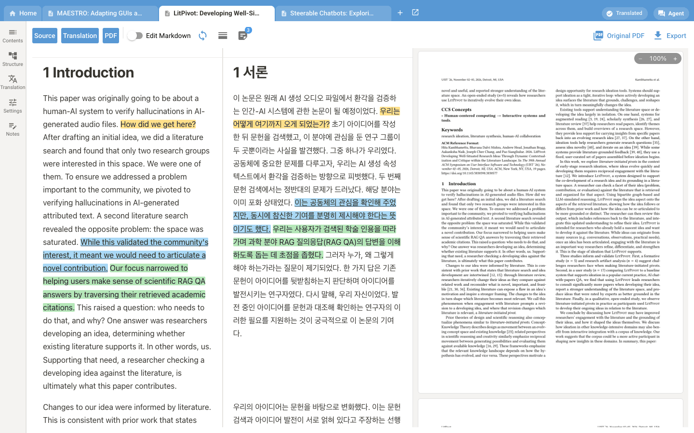

Narani turns a paper PDF into clean text on your own computer, translates it with AI, and shows the source, the translation and the PDF side by side.

- **Read source and translation together.** Hover a sentence and its counterpart on the other side lights up. The PDF follows the page you are reading.
- **Mark as you read.** Highlights and notes attach to both the source and the translation, and every paper has its own notepad.
- **Pick your native language.** Translate into Korean, Japanese, Simplified Chinese, Spanish and many more. The interface itself comes in English, Korean, Japanese, Chinese and Spanish.
- **Read on your phone.** Papers you send from the desktop open offline in a phone web app, and notes you make there come back to the desktop.
- **Ask your papers.** The agent panel searches and reads your papers to answer, and every answer links to the paragraph it came from.

To contribute or use the command line, see the [developer guide](docs/DEVELOPMENT.md) (in Korean).

## Contents

- [Read this first](#read-this-first)
- [Install](#install)
- [First launch — AI key and languages](#first-launch--ai-key-and-languages)
- [Home — adding and organizing papers](#home--adding-and-organizing-papers)
- [Reading a paper](#reading-a-paper)
- [Translation](#translation)
- [Fixing the structure](#fixing-the-structure)
- [Agent panel](#agent-panel)
- [Reading on mobile](#reading-on-mobile)
- [Export and save locations](#export-and-save-locations)
- [Cost](#cost)
- [Troubleshooting](#troubleshooting)

---

## Read this first

**Most of this app's code was written by AI (Claude Code)** and has not been reviewed line by line by a person. It is a personal research tool, published as is.

- **No warranty (AS-IS).** It can break at any time, and it can quietly produce wrong results.
- **Extraction can drop content.** Tables, equations, two-column layouts and footnotes are the weak spots. Check anything important against the **original PDF** on the right of the screen.
- **Translation is done by AI.** It can mistranslate or skip things, and the app may not notice if a number or citation changes.
- **Translating sends the paper's text to an AI company.** Translation, glossaries and the agent send text to OpenAI, Anthropic or Google. Don't use them on unpublished manuscripts or confidential documents. Turning the PDF into text (extraction) runs only on your computer.
- **AI usage is billed to your own key.** Translating one paper usually costs a few cents (→ [Cost](#cost)).
- **Your AI key is stored in plain text** in a settings file on your computer (`~/.config/narani/config.toml`, readable only by you). Be careful on shared computers.

---

## Install

### One-line install (recommended)

Paste the line below into a terminal. It downloads everything and creates a **Narani icon**. You don't need to install Python yourself.

**macOS / Linux** — in the Terminal app:
```bash
curl -LsSf https://raw.githubusercontent.com/wooogler/narani/main/install.sh | sh
```

**Windows** — in PowerShell:
```powershell
irm https://raw.githubusercontent.com/wooogler/narani/main/install.ps1 | iex
```

- The first install downloads about 1.3 GB and takes a few minutes. The first PDF you convert downloads the extraction model (about 1.1 GB) once more.
- When it finishes, **Narani** appears in Launchpad (macOS) or the Start menu (Windows). Click it to open the app window.
- You can read the scripts first: [install.sh](install.sh) · [install.ps1](install.ps1).

| You need | Details |
|---|---|
| OS | macOS (Apple Silicon or Intel), Windows 10/11, Linux |
| Disk | About 2.5 GB (1.3 GB app + 1.1 GB extraction model) |
| Memory | 4 GB or more recommended. No GPU needed |
| AI key | Only for translation and the agent. One of OpenAI, Anthropic or Google Gemini |

### Updating

Each time the app starts it checks for a new version and tells you in the **bottom-right corner**. Click **Update and restart** and the app closes and reopens on the new version. Running the install line again also gets you the latest version.

### Uninstalling

In a terminal:
```bash
narani app --remove && uv tool uninstall narani
```
Your converted papers (`~/narani`) and settings (`~/.config/narani`) stay. Delete them yourself if you no longer need them.

### Coming from md4paper

md4paper is Narani's old name. The old app's auto-update can't make the jump, so run the install line above once. On first launch Narani moves your keys, collections, Drive connection and papers to the new folders (`~/.config/narani`, `~/narani`) and removes the old icon.

---

## First launch — AI key and languages

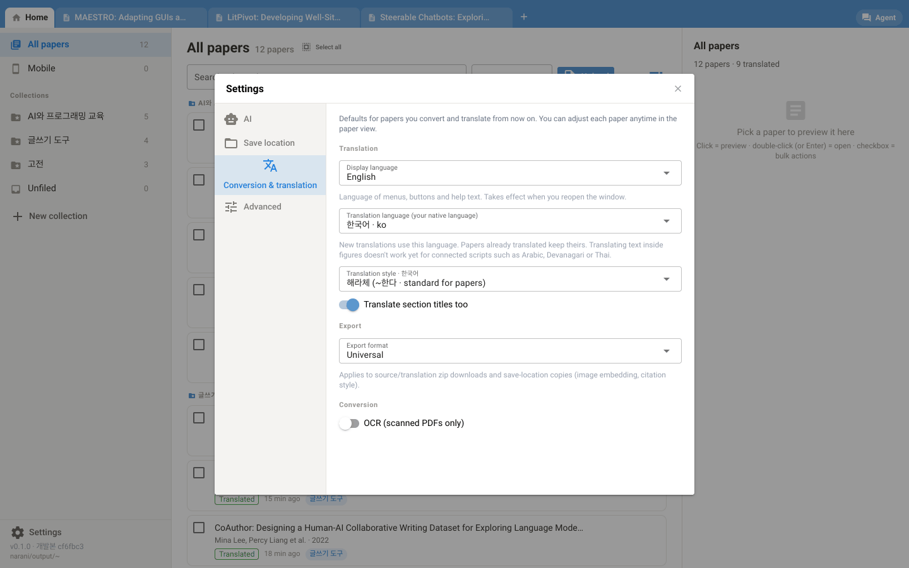

Open **⚙ Settings** at the bottom left of Home.

1. **AI** tab — pick a service (OpenAI, Anthropic or Google), paste your API key and click **Test connection**. Without a key you can still turn PDFs into text and read them. When no key is set, a thin warning bar appears above the Home list; clicking it opens this tab.
2. **Conversion & translation** tab
   - **Display language** — the language of menus and buttons: 한국어, English, 日本語, 简体中文 or Español. It takes effect when you reopen the window.
   - **Translation language (your native language)** — papers are translated into this language. Korean, Japanese, Simplified Chinese and Spanish come with style presets, and you can pick other languages too (French, German, Vietnamese and more). Papers you already translated keep their language.
   - **Style** — per language, for example Korean 해라체 (academic) · 합니다체 · 해요체, or Japanese である調 · です・ます調.
   - **Translate section titles too**, the export format, and OCR for scanned PDFs are here as well.
3. **Save location** — a folder where translated Markdown piles up (→ [Export and save locations](#export-and-save-locations)).
4. **Advanced** — caption, run-in heading, author and citation styles, reference links, BibTeX, metadata lookup, file-name rule.

> When you open the app from its icon it can't see environment variables set in your terminal (such as `OPENAI_API_KEY`). Save the key in **⚙ Settings → AI**.

---

## Home — adding and organizing papers

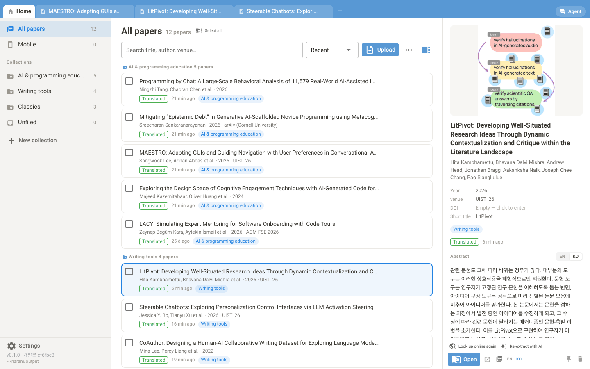

Home has three columns: **collections** on the left, the **paper list** in the middle and a **preview** of the selected paper on the right.

### Adding papers

- **Drag PDFs onto the window**, or click **Upload** above the list. Several files are processed one after another, and `.md` files that are already Markdown are accepted too.
- New papers go into the **collection selected on the left**.
- After conversion Narani looks up the metadata (title, authors, year, venue) and renames the folder, e.g. `2026_LitPivot_Kambhamettu`.

### Selecting and opening

- **Click a card once** to see its preview on the right: a lead figure, metadata, collections, status and the abstract (switch between source and translation).
- **Double-click** (or press Enter), or click **Open** under the preview, to open the paper. The same row has open in a new window, original PDF, source/translation zip, 📌 pin, and hide/delete.
- The search box above the list finds titles, authors and venues. You can sort by recent, title, year, or translated first.

### Fixing metadata

In the preview, **click** the title, authors, year, venue, DOI, short title or abstract to edit it in place. **Enter** or clicking outside saves; **Esc** cancels. Fields you edit by hand are never overwritten by later lookups. **Look up online again** fetches the publication record from OpenAlex and Crossref; **Re-extract with AI** reads the metadata again from the first pages.

### Collections

- Create groups with **New collection** on the left (a thesis survey, this semester's class…). Collections can have subcollections.
- **A paper can belong to several collections.** Click the collection tag on a card to add or remove it, or drag the card onto a collection on the left to add it.
- The **⋯** menu on a collection has new subcollection, rename, set folder, **Glossary…**, settings and delete. Deleting a collection keeps its papers and files.
- **Mobile** on the left lists only the papers you sent to your phone (→ [Reading on mobile](#reading-on-mobile)).

### Many papers at once — batch translation

Tick the checkboxes on the left of the cards and the preview turns into an **N selected** panel.

- **Translate (N)** — translates the selected papers in one go. Before starting it shows a breakdown ("3 not translated · 1 with outdated sections · 2 up to date") and the **estimated cost**. You can include figure text translation.
- **English zip · Translation zip**, **Send to mobile · Remove from mobile**, **Add to collection · Remove from collection**, **Save to folder**.

### Tabs and windows

- Opening a paper adds a **tab** at the top. Click a tab to go straight to that paper; tabs survive restarts. **+** next to the tabs finds a converted paper and opens it in a new tab.
- **⧉** next to the tabs opens the paper in a **new window**, for comparing two papers truly side by side (the same paper is never open in two windows).
- Long jobs such as translation keep running when you switch tabs or go Home. The paper's tab icon spins, and a notice appears when it finishes.

---

## Reading a paper

The middle of a paper's screen is the **canvas**. The **Source / Translation / PDF** buttons at the top switch columns on and off. The five buttons on the left rail (**Contents · Structure · Translation · Settings · Notes**) switch the side panel; click the active one again to fold the panel away and widen the canvas.

- **Contents** — click a section title to jump there. Translated titles appear on a second line.
- **Sentence pairs** — with source and translation side by side, hovering a sentence highlights its counterpart. With one column, click a sentence to see its counterpart in a bubble. Sentences that couldn't be paired are marked in gray.
- **Citations and footnotes** — click a citation like `[12, Díaz & Contell 2022, …]` to see the reference, or a figure number to jump to the figure.

### Reading against the PDF

- Turn on the **PDF** column and the original PDF appears on the right. As you read, **the page containing your reading position moves to the top of the PDF column**; if that page is already fully visible, the PDF stays put. Turn following off with the ↻ toolbar button.
- Use the **zoom bar [− 100% +]** above the PDF. Trackpad pinch and ⌘/Ctrl+wheel also work, and ⌘/Ctrl+0 goes back to 100%.
- Turn off Source and leave PDF on to read the PDF large. **Original PDF** on the right of the toolbar opens it in your default PDF app.

### Highlights and notes

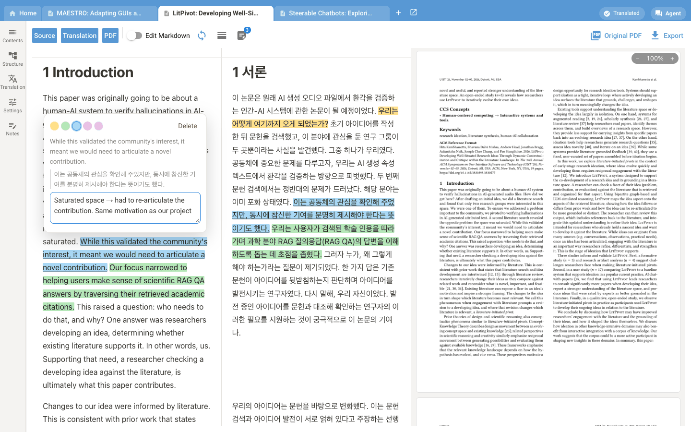

- **Double-click a sentence** to color it **in the same color on both the source and the translation**, with a note field open.
- **Drag over text** to color just that span. Pick a color (yellow, green, blue, pink, purple) from the bar that appears, or click **Add note**.
- Click a highlight again to change its color, edit its note or delete it. Notes save automatically.

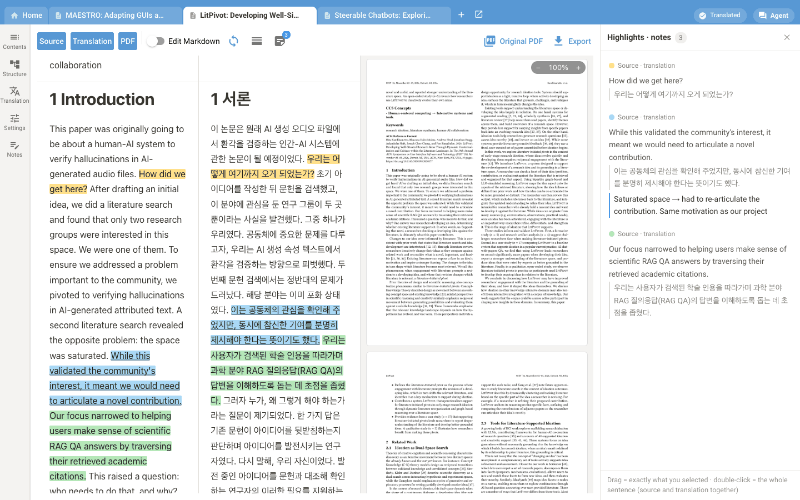

The **notes icon** in the toolbar (with a count badge) opens the **highlights & notes list** on the right; click an item to jump to it. If the text changes after retranslation, highlights find their place again by their wording; any that can't be found stay in the list as `Not found`. **Export → Highlights & notes (md)** at the top right saves the quotes (source and translation) and notes as a single Markdown file.

### Notepad

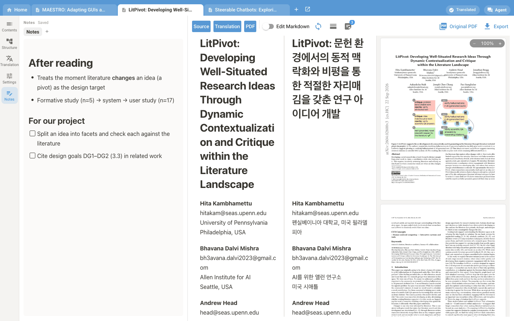

**Notes** on the left rail is a notepad for the whole paper. You edit what you see (no Markdown syntax needed), and typing `/` inserts tables, checklists, code blocks and so on. Keep several notes as tabs, and drag a tab to the bottom of the notes area to split it and see two notes at once. Everything saves automatically.

### Back to where you were

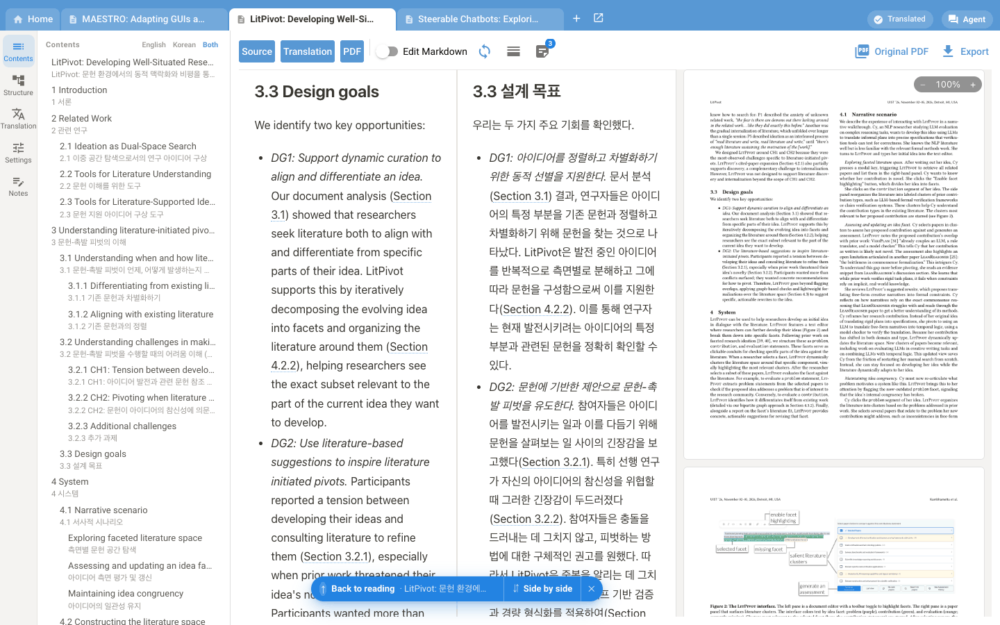

When you jump somewhere through the table of contents, a citation, a figure number, search or the notes list, a **↑ Back to reading** pill appears at the bottom. Click it to return to where you were. After several jumps it steps back one at a time, like a browser's Back button.

Switching tabs and coming back also restores the panel you had open and your scroll position.

### Two viewers, top and bottom

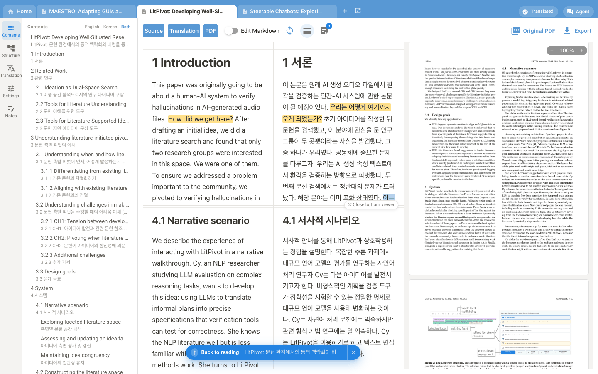

The **horizontal split button** (≡) in the toolbar splits the same paper into **top and bottom panes** — read the introduction while keeping the method or a figure open below.

- While split, jumps from the table of contents or citations open in the **bottom pane** and the top pane keeps your place.
- If you jumped without splitting, click **⇅ Side by side** on the pill: the bottom pane shows where you jumped and the top pane returns to where you were reading.
- Drag the bar in the middle to resize; **× Close bottom viewer** closes it. The PDF follows whichever pane you touched last.

### Figures

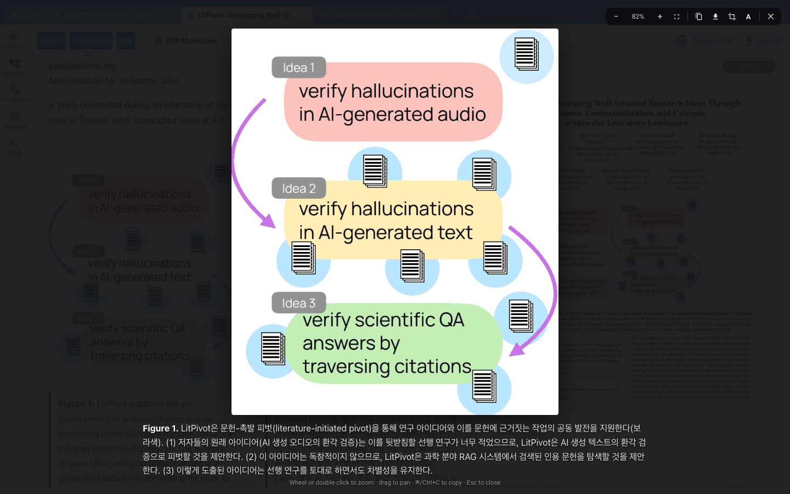

- **Click a figure to zoom it full screen.** Wheel, pinch or `+`/`-` changes the zoom; drag to pan; double-click or `0` fits; `Esc` closes.
- **Figure description** — if the authors added accessibility descriptions (alt text) to the PDF (e.g. ACM final versions), a **Figure description** section opens under the zoomed figure.
- **Translate figure text** — the **가** button makes a copy of the figure with axis labels, legends and box text in your translation language and puts it in the translation column. The figure is not redrawn by AI: only the text areas are repainted from the original, so lines, bars and numbers stay exactly as they were. The same menu switches between original and translated figures, edits the translation, or removes it. One figure usually costs less than a cent.
- **Re-crop (✂)** — if a figure caught part of its neighbor or was cut in half, pick the area again on the PDF page and it is re-cropped at high resolution.

### Equations

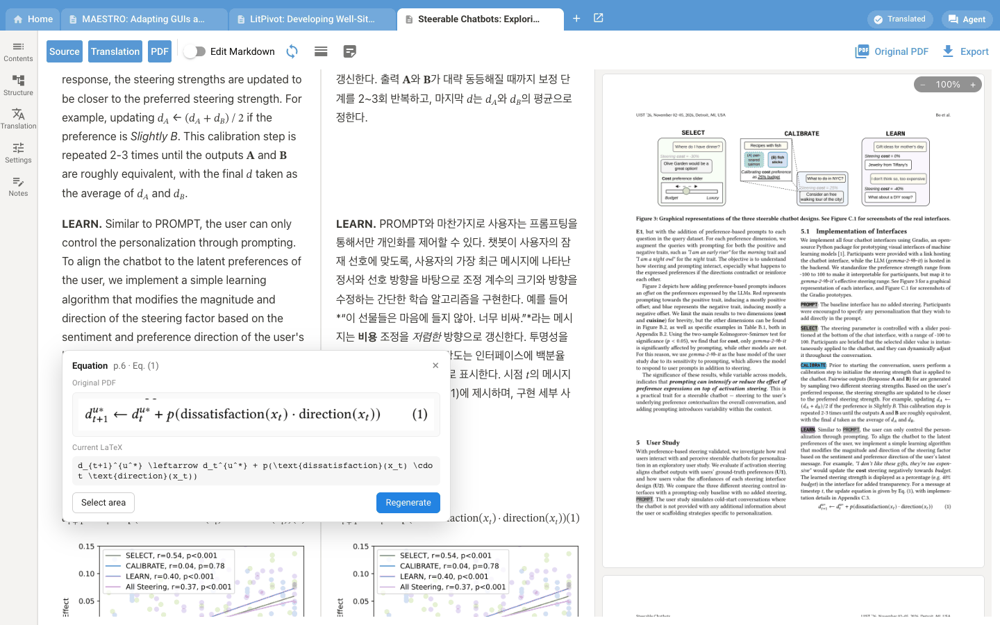

Click an equation to see **the equation cropped from the original PDF** next to its current LaTeX, so you can check them against each other. If it's wrong, **Regenerate** has the AI read it again; check the preview, then **Apply**.

### Find

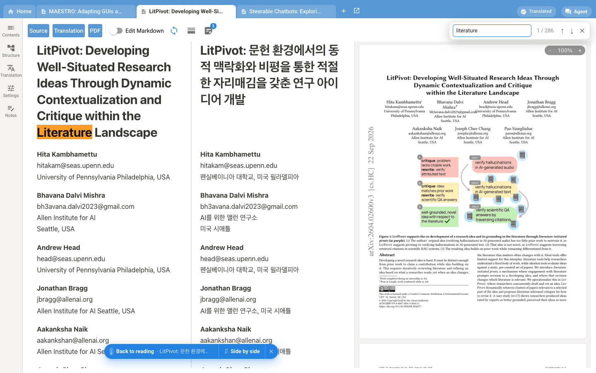

**⌘F / Ctrl+F** opens a find bar on every screen. It counts matches (`3 / 26`), marks them all in yellow and the current one in orange. **Enter** next, **Shift+Enter** previous, **Esc** close.

---

## Translation

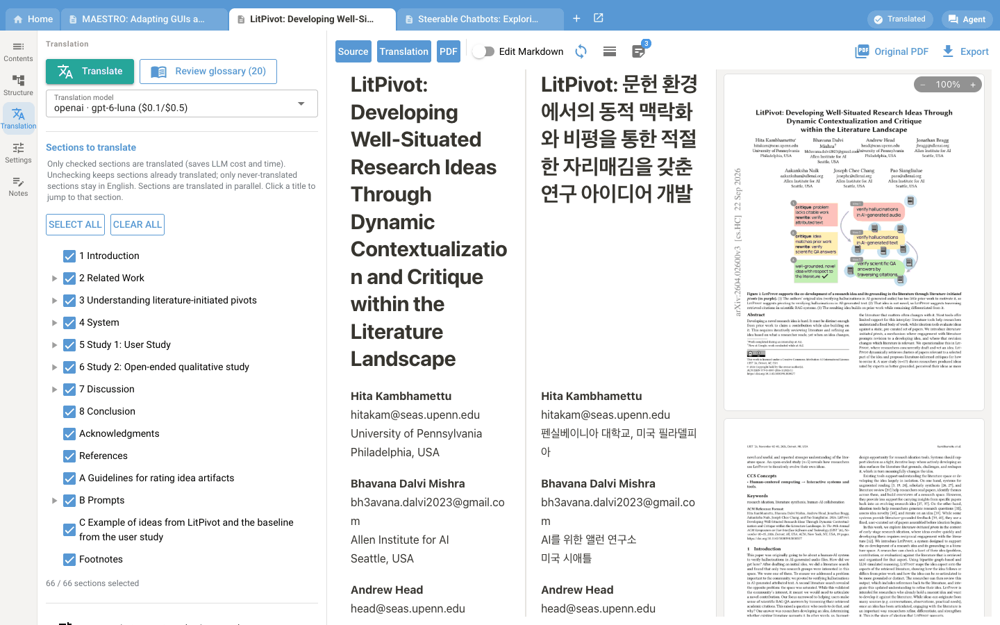

This is the **Translation** panel on the left rail. The `Not translated · Translate` chip in the header opens it too.

1. Choose the **sections to translate**. Unticked sections stay in the source language (you usually skip the references).
2. If you like, **Review glossary** first to settle the terms (below).
3. Click **Translate**. When it finishes, the translation column turns on in the canvas and the actual cost is shown.

Choose the model at the top of the panel. Translated paragraphs are kept, so if you fix the structure and translate again, only changed paragraphs are retranslated.

### Glossary

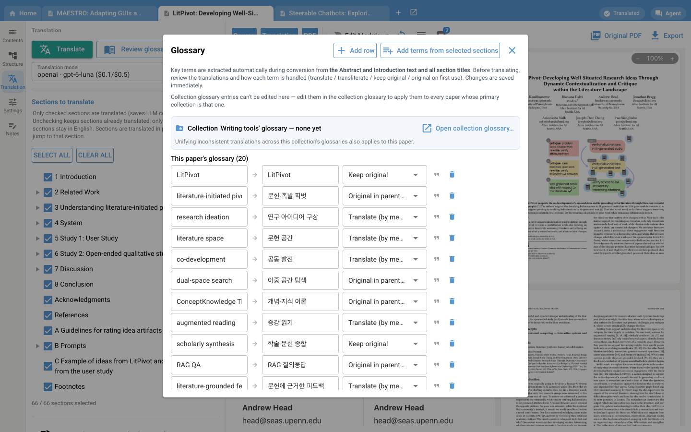

During conversion Narani pulls key terms from the abstract, introduction and section titles. **Review glossary** opens a table where you fix translations and handling before translating.

- Handling: **Translate (by meaning)** · **Transliterate (by sound)** · **Keep original** · **Original in parentheses on first use** (e.g. "문헌-촉발 피벗(literature-initiated pivot)").
- Translation follows this glossary, so terms stay consistent across the paper.
- **Collection glossary** — under a collection's **⋯ → Glossary…**, set terms shared by every paper in that collection. They override paper glossaries, and you can unify a term that different papers translated differently. Before applying a change it shows how many sections would be retranslated and what it would cost.

### Notation settings

The **Settings** panel on the left rail changes citation style (number, author–year, short name, in combination), reference links, captions and author formatting. Changes apply to both source and translation **without retranslating**.

---

## Fixing the structure

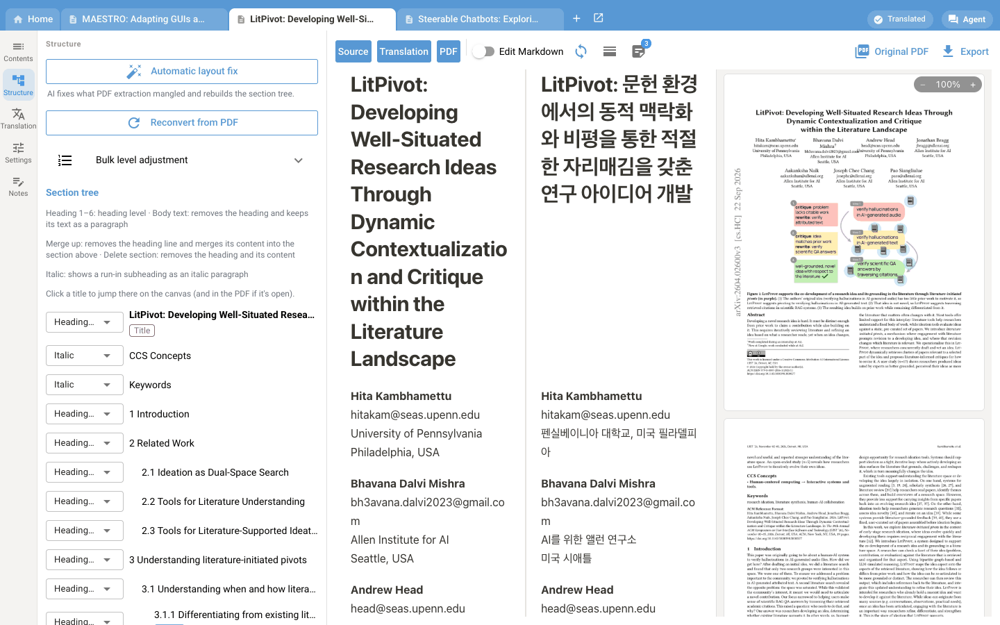

Turning a PDF into text sometimes gets heading levels wrong or breaks paragraphs. Fix that in the **Structure** panel on the left rail.

- **Automatic layout fix** — AI finds split headings, scattered equations and broken paragraphs, lists and tables across the paper and repairs them. It doesn't change the words, and **Restore previous state** undoes it.
- **Section tree** — set each heading's level (Heading 1–6), or turn it into body text, merge it into the one above, or delete it. Narani remembers these choices and applies them to the next paper in the same venue format.
- **Bulk level adjustment** — groups numbering like `3.2.1` by depth so you can set levels in one go.
- **Reconvert from PDF** — start over from the PDF.
- **Edit Markdown** — the toolbar toggle lets you edit the text directly, in either the source or the translation. Markdown is styled as you type, with shortcuts such as ⌘/Ctrl+B (bold), I (italic), K (link), ⌘/Ctrl+⌥1–6 (headings) and ⌘/Ctrl+⇧8 (list). It saves when you stop typing.

---

## Agent panel

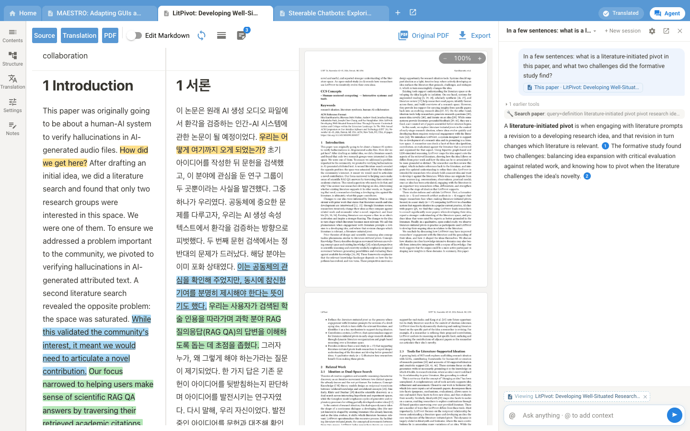

Open it with the **Agent** button at the top right. It takes a column on the right and keeps the conversation as you move between Home and papers. It needs an AI key.

- **It works across all your papers.** It searches papers, reads paragraphs, contents, notes and highlights as needed, then answers. You can also ask it to move the screen: "go to section 4", "open that paper."
- **Click a source number in the answer** to jump to that paragraph. If it's in another paper, that paper opens first.
- **It knows what you're looking at.** The paper or collection you're viewing and any selected text go along with your question, so "this paragraph" and "the selected sentence" work. Type **@** in the input to add another paper, section or note as context.
- **Actions such as writing notes, adding highlights or retranslating** show an approval card and run only after you allow them.
- Conversations are kept as sessions. Click the session name in the header to pick an earlier one; ⚙ changes the model and text size.

---

## Reading on mobile

<p>
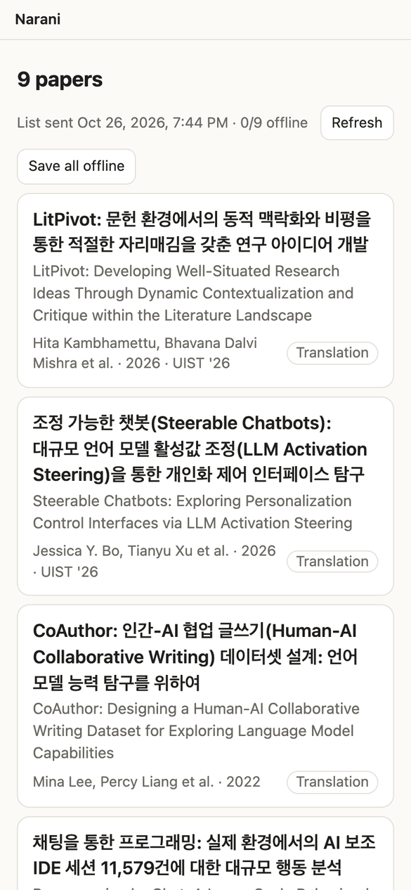
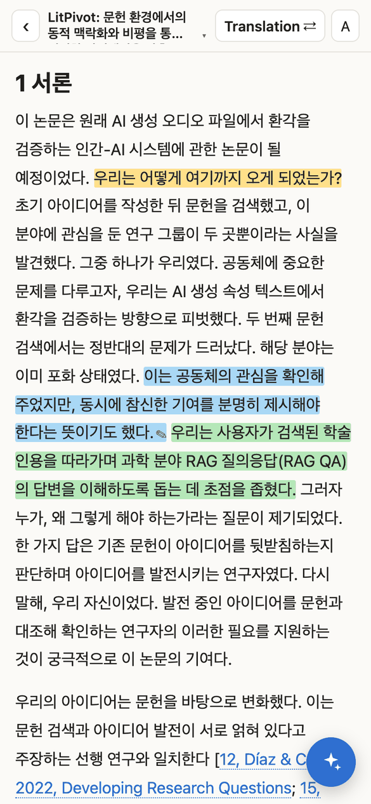
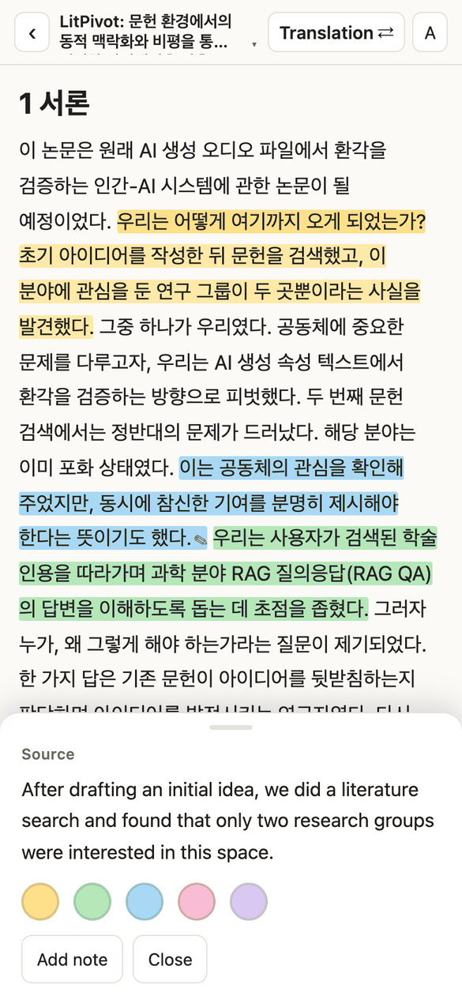
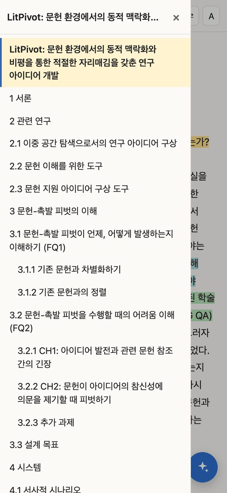
</p>

Read papers translated on the desktop on your phone or tablet, and exchange highlights and notes made on the phone with the desktop.

- **There is no server.** Papers travel through a **`Narani` folder in your own Google Drive**. The desktop can be off while you read on the phone.
- **Phone web app: https://narani.sangwooklee.info/** — not an app-store app, but a web app you add to your home screen.
- **Narrow permissions.** It uses one permission (`drive.file`) that only sees files Narani created, so it can't see anything else in your Drive. Your desktop AI key never goes to the phone.

### 1. Send papers from the desktop

1. On Home, tick the papers to send and click **Send to mobile**.
2. The first time, a Google sign-in opens in your browser. Sign in and allow access; a `Narani` folder is created in your Drive and the papers are uploaded. (You can also connect first with **Mobile → Connect Google Drive** in the sidebar.)
3. To send many at once, use **⋯ → Send all translated papers in this list to mobile** at the top right of the list.
4. You can also drag a paper card onto **Mobile** in the left sidebar.

Sent papers get a 📱 mark on their card and are listed under **Mobile** in the sidebar. Its header shows the connected account, paper count, size, last sync, **Sync now** and **Disconnect**.

### 2. Install on your phone (add to home screen)

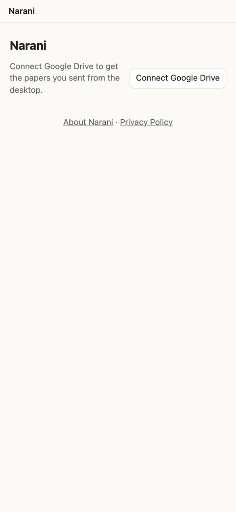

**iPhone / iPad (Safari)**
1. Open https://narani.sangwooklee.info/ in **Safari** (the most reliable way).
2. Tap the **Share** button (a square with an arrow) at the bottom (top on iPad).
3. Scroll down, tap **Add to Home Screen**, then **Add** at the top right.
4. From now on, open it from the **Narani icon on your home screen**. The home-screen app and Safari tabs keep separate storage, so connect Drive and save papers offline in the app opened from the icon.

**Android (Chrome)**
1. Open https://narani.sangwooklee.info/ in **Chrome**.
2. In the **⋮** menu at the top right, tap **Add to Home screen** (or **Install app**), then **Install** / **Add**.
3. Open it from the **Narani** icon on your home screen or app drawer.

**After first opening:** tap **Connect Google Drive** and sign in with **the same Google account** as on the desktop. The papers you sent appear.

<br clear="right">

### 3. Reading on the phone

- **List** — the papers you sent from the desktop. **Refresh** reloads the list from Drive.
- **Offline mode** — turn on **Offline mode — save all** above the list to keep every paper and its desktop highlights and notes on the phone; each time the app opens it fetches only what's new or changed (planes, subways). Papers you've opened are kept either way. Without internet the list says so, and papers that aren't saved are dimmed.
- **Top bar** — **‹** back to the list. Tap the **title** to slide out the **table of contents** from the left, with the current section marked. **Translation ⇄** switches between translation and source; **A** changes the text size.
- **Tap a sentence** and its **counterpart** (the source, if you're reading the translation) slides up from the bottom. Tap a citation to see the reference.
- **Your notes** — the **Notes** tab of the **💬** button at the bottom right lists this paper's highlights and notes in reading order (filter with **Notes only**); tap one to jump there. The number on the button is the count.

### 4. Highlights, notes and sync

- Tap a sentence, then pick a **color** to highlight it or tap **Add note** to add a note. Both sentences of the pair are colored (just like a double-click on the desktop), and noted ones get a ✎.
- **Phone → desktop**: highlights from the phone go to Drive and are merged into the desktop's highlights **when the desktop app starts** (or with **Mobile → Sync now** in the sidebar). Marks made offline wait on the phone and upload once you're connected.
- **Desktop → phone**: when the desktop app starts it re-uploads papers you retranslated or edited, plus new notes. The phone picks them up when you open the app (or tap **Refresh**).
- If the paper was open in the desktop viewer during a sync, reopen it to see the phone's notes.

### 5. Ask on the phone (optional)

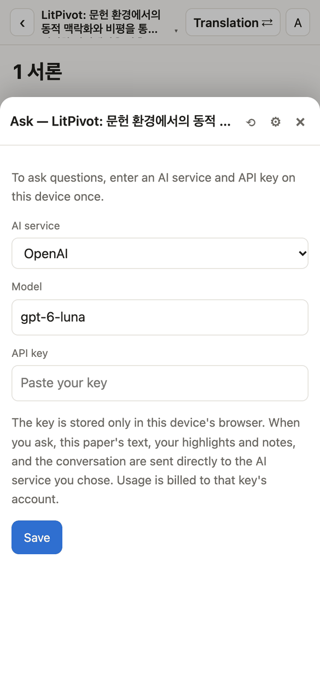

Pick **Ask** in the **💬** button at the bottom right to ask about the paper you're reading. Tap a source like [r12] in the answer to jump to that paragraph.

- The first time, enter **your own AI API key** (OpenAI, Anthropic or Gemini) **on that device**. The key is stored only in that device's browser.
- When you ask, the paper's text, your highlights and notes, and the conversation go directly to the AI service you chose, billed to that key's account.
- The default service and model follow what you chose in the desktop agent panel.
- **Ask by voice (🎙)** — while listening, tap the **🎙 Ask** button at the bottom right (or 🎙 in the Ask tab): listening pauses and you ask and hear answers by voice (OpenAI realtime, needs an **OpenAI key**). You can interrupt; the supporting paragraph is shown and the conversation is kept in the Ask history. Say "keep reading" or stay quiet for 20 seconds to end it and continue listening where you were. Keep the screen on (locking it stops the microphone). Roughly $0.1–0.3 per 10 minutes; model and voice under ⚙ in the Ask tab.

<br clear="right">

### 6. Listening (optional) — screen off, even in the car

Make audio of the translation read aloud on the desktop, then listen on the phone.

- **Make it (desktop, macOS only for now)** — on Home, tick papers and click **Make mobile audio**. Pick a voice (**Preview** to hear it) and, for a single paper, the sections to include. The audio goes to the `Narani` folder in your Drive (about 15 MB per hour), and papers with audio get a 🎧 on their card.
  - **Free — Mac voice**: made on this computer; an hour of audio takes a few minutes. Download **Yuna (Premium)** in System Settings → Accessibility → Spoken Content → System voice → Manage Voices for a much more natural voice; it's picked first when present.
  - **Qwen3 — free, local (Apple Silicon Mac)**: an open model (Qwen3-TTS 0.6B) far more natural than the Mac voice. Click **Install** in the dialog once to set up a small environment kept separate from the app (a few hundred MB); the model (about 2.5 GB) downloads the first time you make audio. It runs offline and free but takes about 50 minutes per hour of audio (M5 · 16 GB; more if memory is tight). It runs as a background job.
  - **Gemini (paid)**: more natural voices. Available once you add a **Gemini key** in Settings → AI; the dialog shows the estimated cost (an hour of audio is about $0.5 with flash-lite, $0.8 with flash — double from 2027). The paper's translated text is sent to Google with your key and billed to that account. Paid audio isn't remade automatically when you change a translation (the phone marks it as outdated) — remake it when you want.
- **Pronunciation glossary** — decide how English names and acronyms left in the translation (Hedwig, RAG, LLM…) are read. Expand **Pronunciation glossary** in the make-audio dialog to see the paper's frequent English terms, use **Fill with AI** for a draft (with your translation AI key, a fraction of a cent), adjust, then create. Blank terms are left to the voice; changing the table remakes only the sections that use those terms. English glosses in parentheses after Korean words, like `프롬프팅(prompting)`, aren't read twice.
- **What it reads** — title, abstract and body, announcing section titles. Figures, tables, equations, citation marks, footnote numbers, references and appendices are skipped.
- **Listen (phone)** — open a paper with audio and a **🎧** button appears above 💬. It starts **where you were looking**; the bar at the bottom has play, 15 seconds back/forward, previous/next section and speed. **Range** plays just this section, from here on, or chosen sections. While the bar is up, tapping a sentence plays from it right away (close the bar to highlight or add notes); otherwise tap a sentence and choose **Listen from here**.
- **Range** — **Range** on the bar: start to finish · this section only · from here to the end · choose sections.
- **With the screen on**, the sentence being read is highlighted and the page follows along. **With the screen off** it keeps playing, and the lock screen, CarPlay and earbud buttons play/pause and move between sections. Your place is remembered and the paper opens there next time.
- **Offline** — audio is saved the first time you play it. With **Offline mode** on, **Save audio too** downloads it all in advance (use Wi-Fi).
- When you change a translation, the next desktop start remakes free-voice audio (Mac, Qwen3) for the changed sections only. Switching voices keeps the pieces made with the other voice, so switching back doesn't synthesize again. To delete audio, tick papers and click **Delete mobile audio**.

### 7. Getting a new version

The web app checks for a new version in the background each time it opens. The new version takes effect **after you fully close the app and open it again**.

- **iPhone** — swipe up from the bottom to open the app switcher, swipe Narani away, then open it again.
- **Android** — swipe Narani away in the recent apps list, then open it again.

Papers and notes you've downloaded stay.

### Good to know

- Google sign-in on the phone may ask you to **Reconnect** after about an hour. Downloaded papers stay readable.
- Papers whose source and translation have a different number of sections couldn't be aligned, so you can't add new highlights to them on the phone (desktop highlights still show).
- To take a paper off the phone, tick it on the desktop and click **Remove from mobile**. Phone notes are merged into the desktop first; the paper's files stay.
- To disconnect, use **Mobile → Disconnect** in the sidebar. Files already in Drive remain; delete the `Narani` folder in Drive if you don't need them.
- How Google data is used: [Privacy policy](https://narani.sangwooklee.info/privacy.html) · [About](https://narani.sangwooklee.info/about.html)

---

## Export and save locations

### Export

**Export** at the top right of a paper offers **English Markdown (zip)**, **Translated Markdown (zip)** and **Highlights & notes (md)**. Choose where it's going under **Format** in the same menu.

| Format | For | How to bring it in |
|---|---|---|
| **Universal** (default) | GitHub, Markdown editors like VS Code or Typora, Pandoc, pasting into an LLM | Unzip and open the `.md`. Keep the `.md` and the `images/` folder together or figures won't show |
| **Notion** | Notion | **Import → Markdown & CSV** at the bottom left; choose the **zip itself, without unzipping**. Delete the empty `images` page that import leaves behind |
| **Obsidian** | Obsidian | Unzip and copy the `<paper>-en` **folder as a whole** into your vault. Clicking a citation jumps to the reference and ⌘/Ctrl+← returns. **Renaming the folder breaks the figures** |

The originals are always kept in Universal form and converted only on export, so switching formats and exporting again loses nothing.

### Save location — papers pile up in a folder automatically

Instead of downloading zips, choose one folder in **⚙ Settings → Save location** and Markdown lands there whenever a conversion or translation finishes.

```
<save folder>/2026_LitPivot_Kambhamettu.md          ← source
<save folder>/images/2026_LitPivot_Kambhamettu/     ← figures
<save folder>/ko/2026_LitPivot_Kambhamettu.md       ← translation (folder named by language)
<save folder>/pdf/2026_LitPivot_Kambhamettu.pdf     ← original PDF
<save folder>/references.bib                        ← BibTeX
```

- Each collection can have its own folder (collection **⋯ → Set folder…**). Collections without one use the common folder.
- Each collection can also override the file-name rule, export format, BibTeX and auto-save (collection **⋯ → Settings… → Advanced**). Anything not set follows the global settings.
- File names follow the `{year}_{title}_{author}` rule by default; change it in **⚙ Settings → Advanced**.

### BibTeX

Each paper adds one entry to `references.bib` in the save location. Paste it into your manuscript's `.bib`, or bring it into Overleaf or Zotero.

- The citation key matches the file name (`\cite{2026_LitPivot_Kambhamettu}`).
- After conversion Narani **fetches the publication record from Semantic Scholar and Crossref** to fill in DOI, venue and pages. **Only the paper title is sent.** It cross-checks authors and year and changes nothing unless it's sure it's the same paper.
- Entries you added by hand are left alone, and if a write would shrink the file, it is rolled back.

---

## Cost

**Turning PDFs into text (extraction) is free** — it runs only on your computer. What costs money is translation, glossary creation, reference parsing, reading equations, figure-text translation and agent questions.

| Paper | Translation cost (measured 2026-07 with `gpt-5.6-luna`) |
|---|---|
| Short paper (about 50k characters of body text) — measured | about $0.031 |
| Typical conference paper (about 70k characters) | about $0.04 |
| Long paper with appendices (about 240k characters) | about $0.14 |

- The current default model, `gpt-6-luna`, is cheaper per token, so expect about half of the above (not re-measured yet).
- Each equation costs about $0.0005; figure-text translation is under a cent per figure.
- **Batch translation shows an estimate before it starts**, and every translation shows the **actual cost** when it finishes. Paragraphs already translated are never translated again.
- The agent sends only the paragraphs it needs for each question, so it costs far less than translation. If one session passes $2, it asks before continuing.

---

## Troubleshooting

- **Clicking the icon opens nothing** — check the launch log (macOS `~/Library/Logs/narani.log`). Running the install line again usually fixes it.
- **It says there's no AI key** — an app opened from its icon can't see terminal environment variables. Save the key in **⚙ Settings → AI**.
- **Papers I converted are missing from the list** — the working folder points somewhere else. Set **⚙ Settings → Save location → Working folder** back to the old folder.
- **The first conversion is slow** — it's downloading the extraction model (about 1.1 GB). Later ones are faster.
- **The extracted text looks wrong** — fix heading levels or run **Automatic layout fix** in the **Structure** panel, and compare with the PDF column. For scanned PDFs, turn on OCR in **⚙ Settings → Conversion & translation** and convert again.
- **New papers don't show on the phone** — tap **Refresh** in the phone list. If they're still missing, click **Mobile → Sync now** in the desktop sidebar.
- **The phone web app looks old** — fully close the app and reopen it (→ [Getting a new version](#6-getting-a-new-version)).
- **`libGL.so.1` error on Linux** — `sudo apt install -y libgl1 libglib2.0-0` (Debian/Ubuntu).

Other install methods, the command line and file locations are in the [developer guide](docs/DEVELOPMENT.md).

## License

[MIT](LICENSE), with no warranty (AS-IS). All dependencies are MIT, BSD or Apache licensed; there are no GPL/AGPL dependencies.

Copyright in the converted and translated **output** belongs to the original papers' authors. Check for yourself whether you may redistribute it.
