# Narani

*나란히* — 영어 논문을 원문과 내 말 번역으로 나란히 놓고 읽습니다.

*[English](README.en.md) · 한국어*

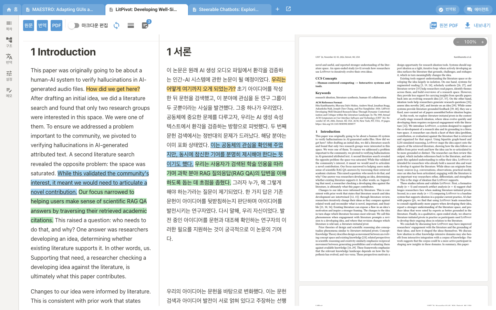

Narani는 논문 PDF를 내 컴퓨터에서 읽기 좋은 글로 풀고, AI로 번역해서 원문·번역·PDF를 한 화면에 나란히 보여 주는 앱입니다.

- **원문과 번역을 나란히 읽습니다.** 문장 위에 마우스를 올리면 반대쪽의 짝 문장이 함께 칠해지고, PDF는 읽는 쪽을 따라옵니다.
- **읽으면서 표시를 남깁니다.** 하이라이트와 메모는 원문·번역 양쪽에 함께 붙고, 논문마다 메모장이 따로 있습니다.
- **모국어를 고릅니다.** 한국어·일본어·중국어(간체)·스페인어를 비롯해 여러 언어로 번역하고, 화면 문구도 한국어·영어·일본어·중국어·스페인어로 바꿀 수 있습니다.
- **폰에서도 읽습니다.** 데스크톱에서 보낸 논문을 폰 웹앱에서 오프라인으로 읽고, 폰에서 단 메모가 데스크톱으로 돌아옵니다.
- **논문에 묻습니다.** 에이전트 창에 질문하면 내 논문들을 찾아 읽고 답하며, 답의 근거 문단으로 바로 이동합니다.

개발에 참여하거나 명령줄로 쓰려면 [개발 문서](docs/DEVELOPMENT.md)를 보세요.

## 목차

- [먼저 알아 둘 것](#먼저-알아-둘-것)
- [설치](#설치)
- [처음 켜면 — AI 키와 언어](#처음-켜면--ai-키와-언어)
- [홈 — 논문 올리기와 정리](#홈--논문-올리기와-정리)
- [논문 읽기](#논문-읽기)
- [번역](#번역)
- [구조 고치기](#구조-고치기)
- [에이전트 창](#에이전트-창)
- [모바일에서 읽기](#모바일에서-읽기)
- [내보내기와 저장 위치](#내보내기와-저장-위치)
- [비용](#비용)
- [문제 해결](#문제-해결)

---

## 먼저 알아 둘 것

이 앱의 코드는 **대부분 AI(Claude Code)가 썼고**, 사람이 한 줄씩 검토하지 않았습니다. 개인 연구용으로 만든 도구를 그대로 공개한 것입니다.

- **무보증(AS-IS)입니다.** 언제든 깨질 수 있고, 틀린 결과를 조용히 낼 수도 있습니다.
- **추출이 내용을 빠뜨릴 수 있습니다.** 표·수식·2단 조판·각주가 특히 약합니다. 중요한 내용은 화면 오른쪽의 **원본 PDF와 대조**하세요.
- **번역은 AI가 합니다.** 오역·누락이 있을 수 있고, 숫자나 인용 번호가 바뀌어도 앱이 알아채지 못할 수 있습니다.
- **번역하면 논문 본문이 AI 회사로 갑니다.** 번역·용어집·에이전트를 쓰면 그 글이 OpenAI·Anthropic·Google 서버로 전송됩니다. 공개 전 원고나 대외비 문서에는 쓰지 마세요. PDF를 글로 푸는 단계(추출)는 내 컴퓨터에서만 돌아갑니다.
- **AI 요금은 내 키의 계정에 청구됩니다.** 논문 한 편 번역에 보통 몇십 원 정도입니다(→ [비용](#비용)).
- **AI 키는 내 컴퓨터의 설정 파일에 그대로 저장됩니다**(`~/.config/narani/config.toml`, 나만 읽을 수 있는 권한). 여럿이 쓰는 컴퓨터라면 조심하세요.

---

## 설치

### 한 줄 설치 (권장)

터미널에 아래 한 줄을 붙여 넣으면 필요한 것을 모두 받고 **Narani 아이콘**까지 만듭니다. 파이썬을 따로 설치할 필요는 없습니다.

**macOS / Linux** — 터미널(Terminal) 앱에서:
```bash
curl -LsSf https://raw.githubusercontent.com/wooogler/narani/main/install.sh | sh
```

**Windows** — PowerShell에서:
```powershell
irm https://raw.githubusercontent.com/wooogler/narani/main/install.ps1 | iex
```

- 처음에는 약 1.3GB를 받으므로 몇 분 걸립니다. 첫 PDF를 변환할 때 추출 모델(약 1.1GB)을 한 번 더 받습니다.
- 끝나면 Launchpad(macOS)나 시작 메뉴(Windows)에 **Narani** 아이콘이 생깁니다. 누르면 앱 창이 열립니다.
- 스크립트 내용은 [install.sh](install.sh)·[install.ps1](install.ps1)에서 미리 읽어 볼 수 있습니다.

| 필요한 것 | 내용 |
|---|---|
| 운영체제 | macOS(Apple Silicon·Intel), Windows 10/11, Linux |
| 디스크 | 약 2.5GB (프로그램 1.3GB + 추출 모델 1.1GB) |
| 메모리 | 4GB 이상 권장. GPU는 없어도 됩니다 |
| AI 키 | 번역·에이전트에만 필요합니다. OpenAI·Anthropic·Google Gemini 중 하나 |

### 업데이트

앱을 켤 때마다 새 버전이 있는지 확인해 **오른쪽 아래**에 알려 줍니다. **업데이트하고 다시 시작**을 누르면 앱이 닫혔다가 새 버전으로 열립니다. 설치 줄을 다시 실행해도 최신 버전이 됩니다.

### 지우기

터미널에서:
```bash
narani app --remove && uv tool uninstall narani
```
변환해 둔 논문(`~/narani`)과 설정(`~/.config/narani`)은 남습니다. 필요 없으면 직접 지우세요.

### md4paper를 쓰고 있었다면

md4paper는 Narani의 옛 이름입니다. 옛 앱의 자동 업데이트로는 넘어오지 못하니 위 설치 줄을 한 번 실행하세요. 처음 켤 때 키·컬렉션·Drive 연결과 논문을 새 폴더(`~/.config/narani`, `~/narani`)로 옮기고, 옛 아이콘은 지웁니다.

---

## 처음 켜면 — AI 키와 언어

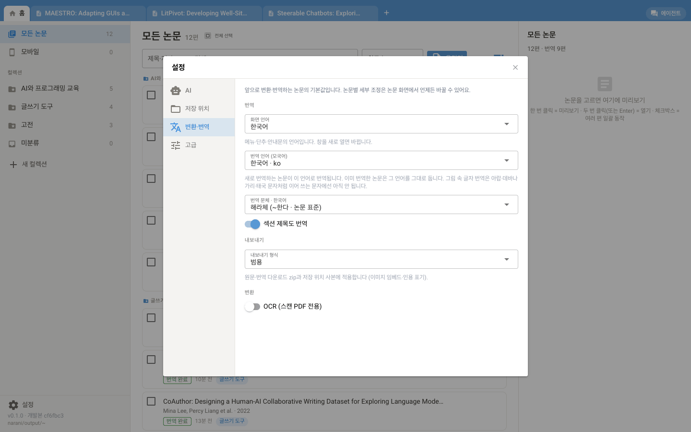

홈 왼쪽 아래의 **⚙ 설정**을 엽니다.

1. **AI** 탭 — AI 서비스(OpenAI·Anthropic·Google)를 고르고 API 키를 붙여 넣은 뒤 **연결 테스트**를 누릅니다. 키가 없어도 PDF를 글로 풀어 읽는 것까지는 됩니다. 키가 없으면 홈 목록 위에 얇은 경고 띠가 뜨고, 누르면 이 탭이 열립니다.
2. **변환·번역** 탭
   - **화면 언어** — 메뉴와 단추의 언어입니다. 한국어·English·日本語·简体中文·Español 중에서 고릅니다. 바꾸면 창을 다시 열 때 적용됩니다.
   - **번역 언어(모국어)** — 논문을 이 언어로 번역합니다. 한국어·일본어·중국어(간체)·스페인어는 문체 선택지가 준비돼 있고, 그 밖의 언어(프랑스어·독일어·베트남어 등)도 고를 수 있습니다. 이미 번역한 논문은 원래 언어를 그대로 둡니다.
   - **문체** — 한국어는 해라체(~한다, 논문 표준)·합니다체·해요체, 일본어는 である調·です・ます調처럼 언어마다 고릅니다.
   - **섹션 제목도 번역**, 내보내기 형식, 스캔 PDF용 OCR도 여기 있습니다.
3. **저장 위치** — 번역한 마크다운을 쌓아 둘 폴더입니다(→ [내보내기와 저장 위치](#내보내기와-저장-위치)).
4. **고급** — 캡션·소제목·저자·인용 표기, 참고문헌 링크, BibTeX, 서지 보강, 파일 이름 규칙.

> 아이콘으로 연 앱은 터미널에서 설정한 환경 변수(`OPENAI_API_KEY` 등)를 보지 못합니다. 키는 **⚙ 설정 → AI**에 저장하세요.

---

## 홈 — 논문 올리기와 정리

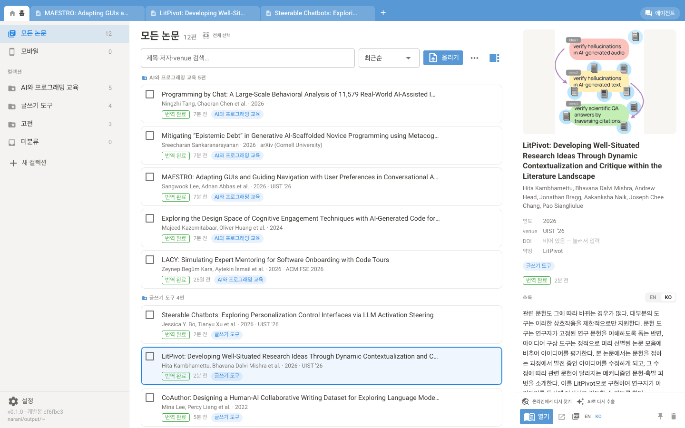

홈은 세 칸입니다. 왼쪽은 **컬렉션**, 가운데는 **논문 목록**, 오른쪽은 고른 논문의 **미리보기**입니다.

### 논문 올리기

- **PDF를 창 위로 끌어다 놓거나** 목록 위의 **올리기**를 누릅니다. 여러 개를 한꺼번에 올려도 차례로 처리하고, 이미 마크다운인 `.md` 파일도 받습니다.
- 새 논문은 **왼쪽에서 고른 컬렉션**에 들어갑니다.
- 변환이 끝나면 서지(제목·저자·연도·학회)를 찾아 폴더 이름을 `2026_LitPivot_Kambhamettu`처럼 정리합니다.

### 논문 고르기와 열기

- 카드를 **한 번 누르면** 오른쪽에 미리보기가 뜹니다. 대표 그림, 서지, 컬렉션, 상태, 초록(원문/번역 전환)이 보입니다.
- **두 번 누르거나**(또는 Enter) 미리보기 아래의 **열기**를 누르면 논문 화면으로 들어갑니다. 같은 줄에 새 창으로 열기, 원본 PDF, 원문·번역 zip, 📌 고정, 숨기기·삭제가 있습니다.
- 목록 위 검색창은 제목·저자·학회를 찾고, 정렬(최근순·제목순·연도순·번역됨 먼저)을 바꿀 수 있습니다.

### 서지 고치기

미리보기의 제목·저자·연도·학회·DOI·약칭·초록은 **눌러서 그 자리에서** 고칩니다. **Enter**나 칸 밖을 누르면 저장, **Esc**는 취소입니다. 손으로 고친 칸은 나중에 온라인 보강이나 AI 재추출이 덮어쓰지 않습니다. 미리보기 아래의 **온라인에서 다시 찾기**는 OpenAlex·Crossref에서 출판 기록을 다시 받고, **AI로 다시 추출**은 본문 앞부분에서 서지를 다시 뽑습니다.

### 컬렉션

- 왼쪽의 **새 컬렉션**으로 묶음을 만듭니다(학위 서베이, 이번 학기 수업 등). 컬렉션 안에 하위 컬렉션도 둘 수 있습니다.
- **논문 하나가 여러 컬렉션에 속할 수 있습니다.** 카드의 컬렉션 태그를 눌러 넣고 빼거나, 카드를 왼쪽 컬렉션으로 끌어다 놓으면 더해집니다.
- 컬렉션 행의 **⋯**에서 하위 컬렉션 만들기·이름 바꾸기·폴더 정하기·**용어집…**·설정·삭제를 합니다. 컬렉션을 지워도 논문과 파일은 그대로입니다.
- 왼쪽의 **모바일**은 폰으로 보낸 논문만 모아 봅니다(→ [모바일에서 읽기](#모바일에서-읽기)).

### 여러 편을 한꺼번에 — 일괄 번역

카드 왼쪽 체크박스로 여러 편을 고르면 미리보기 자리가 **N편 선택** 칸으로 바뀝니다.

- **번역 (N편)** — 고른 논문을 한꺼번에 번역합니다. 시작하기 전에 "번역 없음 3편 · 낡은 섹션 있음 1편 · 최신 2편"처럼 나눠 보여 주고 **예상 비용**을 알려 줍니다. 그림 속 글자 번역도 함께 켤 수 있습니다.
- **영어 zip · 번역 zip**, **모바일로 보내기 · 모바일에서 빼기**, **컬렉션에 추가 · 빼기**, **폴더로 저장**.

### 탭과 새 창

- 논문을 열면 위쪽에 **탭**이 생깁니다. 탭을 누르면 홈을 거치지 않고 그 논문으로 가고, 앱을 다시 켜도 탭이 남아 있습니다. 탭 옆의 **+**는 변환된 논문 목록에서 찾아 새 탭으로 엽니다.
- 탭 옆의 **⧉**는 같은 논문을 **새 창**으로 띄웁니다. 두 논문을 정말로 나란히 놓고 볼 때 씁니다(같은 논문을 두 창에서 열지는 않습니다).
- 번역 같은 오래 걸리는 작업은 다른 탭·홈으로 옮겨도 끝까지 갑니다. 그 논문 탭의 아이콘이 돌고, 끝나면 알림이 뜹니다.

---

## 논문 읽기

논문을 열면 가운데가 **캔버스**입니다. 위쪽의 **원문 / 번역 / PDF** 단추로 보고 싶은 칸만 켭니다. 왼쪽 레일의 다섯 단추(**목차·구조·번역·설정·메모**)가 작업 패널을 바꾸고, 같은 단추를 다시 누르면 패널이 접혀 캔버스가 넓어집니다.

- **목차** — 섹션 제목을 누르면 그 섹션으로 갑니다. 번역이 있으면 번역 제목이 아랫줄에 같이 나옵니다.
- **짝 문장** — 원문과 번역을 나란히 볼 때 문장 위에 마우스를 올리면 반대쪽 짝 문장이 함께 칠해집니다. 한쪽만 볼 때는 문장을 누르면 짝 문장이 말풍선으로 뜹니다. 짝을 찾지 못한 문장은 회색으로 표시합니다.
- **인용·각주** — 본문의 `[12, Díaz & Contell 2022, …]` 같은 인용을 누르면 참고문헌으로, 그림 번호를 누르면 그 그림으로 갑니다.

### PDF와 맞춰 읽기

- **PDF** 칸을 켜면 원본 PDF가 오른쪽에 뜨고, 본문을 읽어 내려가면 **읽는 자리가 든 쪽이 PDF 칸 맨 위**로 따라옵니다. 그 쪽이 이미 다 보이면 PDF는 움직이지 않습니다. 따라오기는 툴바의 ↻ 단추로 끕니다.
- PDF 칸 위의 **확대 막대 [− 100% +]**로 확대합니다. 트랙패드 핀치와 ⌘/Ctrl+휠도 되고, ⌘/Ctrl+0은 100%로 돌아갑니다.
- 원문을 끄고 PDF만 켜면 PDF를 크게 봅니다. 툴바 오른쪽의 **원본 PDF**는 미리보기 같은 기본 PDF 앱으로 엽니다.

### 하이라이트와 메모

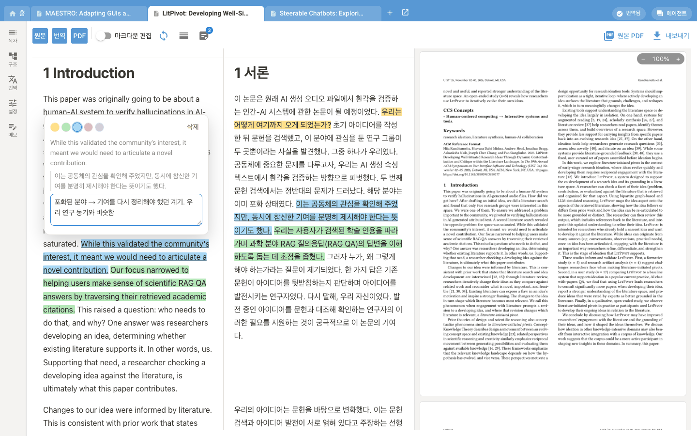

- **문장을 더블클릭**하면 그 문장이 **원문과 번역 양쪽에 같은 색으로** 칠해지고 메모 칸이 열립니다.
- **글자를 드래그**하면 끌어 둔 그 자리에만 칠합니다. 뜨는 막대에서 색(노랑·초록·파랑·분홍·보라)을 고르거나 **메모 달기**를 누릅니다.
- 칠한 곳을 다시 누르면 색을 바꾸고, 메모를 고치고, 지울 수 있습니다. 메모는 자동으로 저장됩니다.

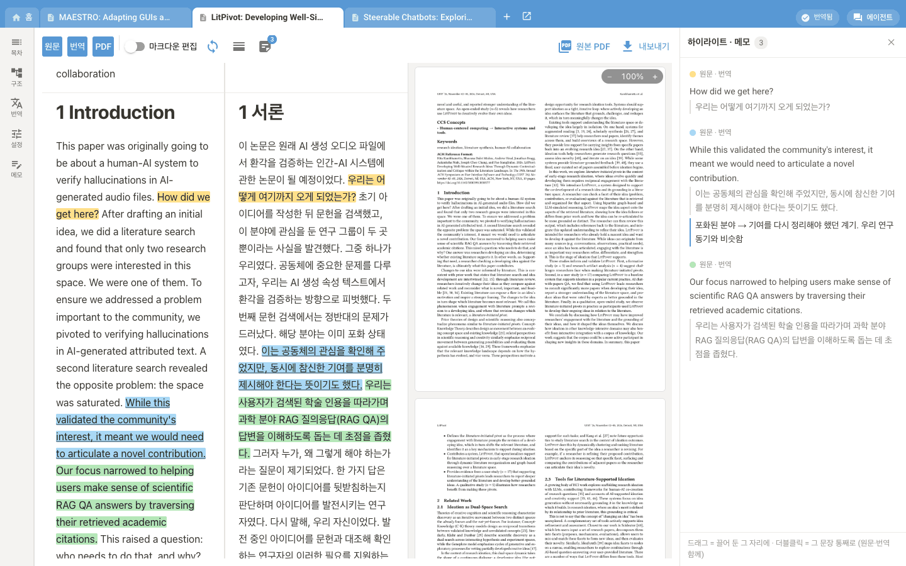

툴바의 **메모 아이콘**(숫자 배지)을 누르면 오른쪽에 **하이라이트·메모 목록**이 열립니다. 항목을 누르면 그 자리로 갑니다. 번역을 다시 해서 본문이 바뀌어도 하이라이트는 글귀로 제자리를 다시 찾고, 끝내 못 찾은 것은 지우지 않고 `위치 못 찾음`으로 남깁니다. 오른쪽 위 **내보내기 → 하이라이트·메모 (md)**로 원문·번역 인용과 메모를 마크다운 한 장으로 받습니다.

### 메모장

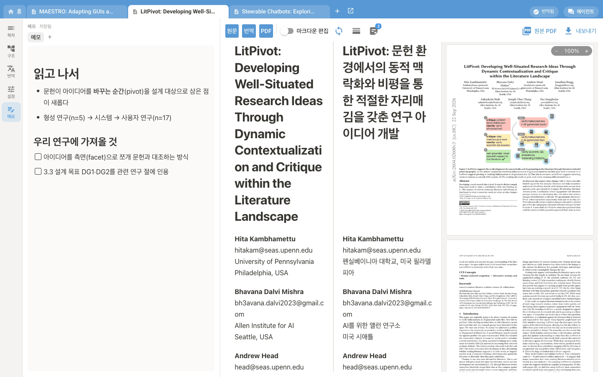

왼쪽 레일의 **메모**는 논문 전체에 대한 메모장입니다. 보이는 그대로 편집하며(마크다운 문법을 몰라도 됩니다), `/`를 치면 표·체크박스·코드 블록 등을 넣습니다. 탭으로 메모를 여러 개 두고, 탭을 메모 칸 아래쪽으로 끌어 놓으면 위아래로 나눠 두 메모를 함께 봅니다. 쓴 내용은 자동 저장됩니다.

### 읽던 자리로 돌아오기

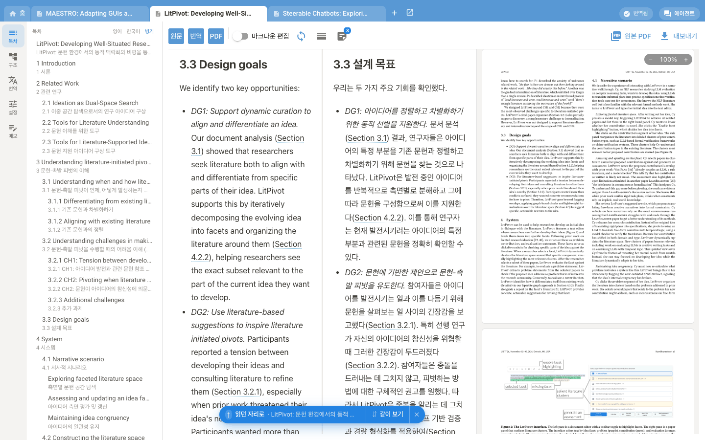

목차·인용·그림 번호·찾기·메모 목록으로 다른 곳에 다녀오면 아래쪽에 **↑ 읽던 자리** 알약이 뜹니다. 누르면 떠나기 전 자리로 돌아갑니다. 여러 번 옮겨 다녔으면 브라우저의 '뒤로'처럼 한 단계씩 돌아갑니다.

탭을 옮겼다 돌아와도 그 논문에서 마지막으로 연 패널과 스크롤 위치가 그대로입니다.

### 위아래 두 뷰어

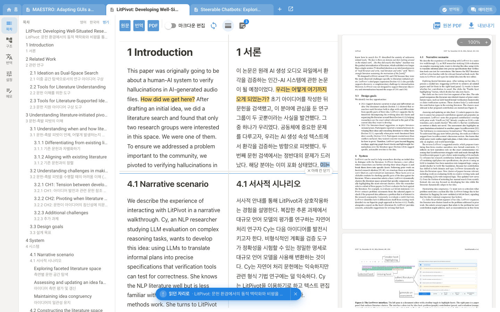

툴바의 **가로 나눔 단추**(≡ 모양)를 누르면 같은 논문이 **위아래 두 칸**으로 나뉩니다. 서론을 읽으면서 아래 칸에 방법 절이나 그림을 띄워 두는 식입니다.

- 나눠져 있는 동안 목차·인용으로 이동하면 **아래 칸**이 그곳을 띄우고, 위 칸은 읽던 자리를 지킵니다.
- 나누지 않은 상태에서 이동했다면 알약의 **⇅ 같이 보기**를 누릅니다. 아래 칸에 방금 간 곳이 뜨고 위 칸은 읽던 자리로 돌아옵니다.
- 가운데 막대를 끌어 높이를 바꾸고, **× 아래 칸 닫기**로 닫습니다. PDF는 마지막으로 손댄 칸을 따라갑니다.

### 그림

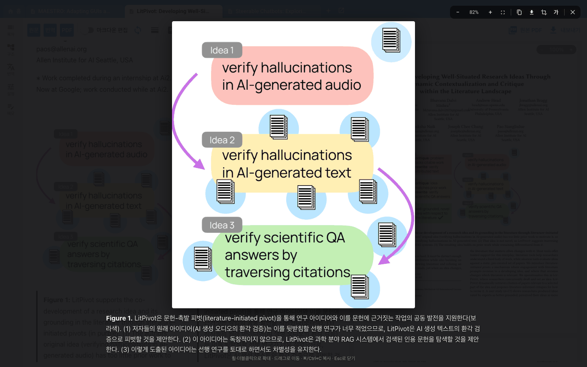

- **그림을 누르면 전체 화면으로 확대**됩니다. 휠·핀치·`+`/`-`로 배율을 바꾸고, 드래그로 옮기고, 더블클릭이나 `0`으로 맞춤, `Esc`로 닫습니다.
- **그림 설명** — 저자가 PDF에 접근성 설명(대체 텍스트)을 달아 둔 논문이면(ACM 최종본 등) 확대 뷰어 아래에 **그림 설명**이 펼쳐집니다.
- **그림 속 글자 번역** — 막대의 **가**를 누르면 축 라벨·범례·상자 글자를 번역 언어로 바꾼 그림을 만들어 번역 칸에 넣습니다. 그림을 AI로 다시 그리지 않고 원본에서 글자 자리만 고쳐 그리므로 선·막대·숫자는 그대로입니다. 원본/번역 그림 바꿔 보기, 번역 고치기, 지우기도 같은 메뉴에 있습니다. 한 장에 보통 1센트도 안 듭니다.
- **영역 다시 지정(✂)** — 그림이 옆 그림까지 물었거나 반쪽만 잘렸으면 PDF 쪽에서 영역을 다시 골라 고해상도로 다시 자릅니다.

### 수식

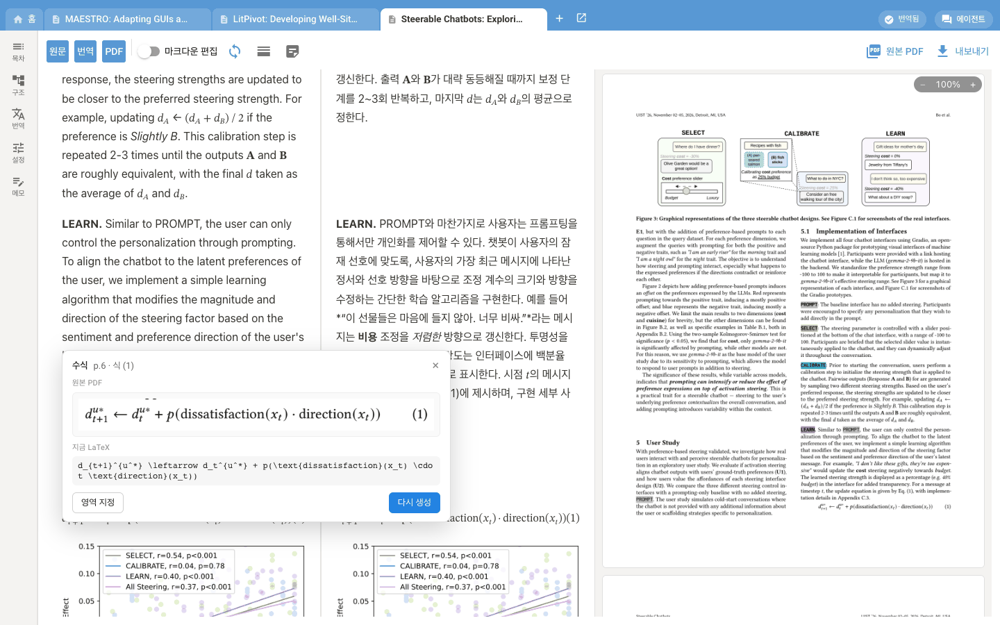

수식을 누르면 **원본 PDF에서 잘라 낸 수식 그림**과 지금의 LaTeX가 함께 떠서 맞는지 대조할 수 있습니다. 틀렸으면 **다시 생성**으로 AI가 다시 읽게 하고, 미리보기를 본 뒤 **적용**합니다.

### 찾기

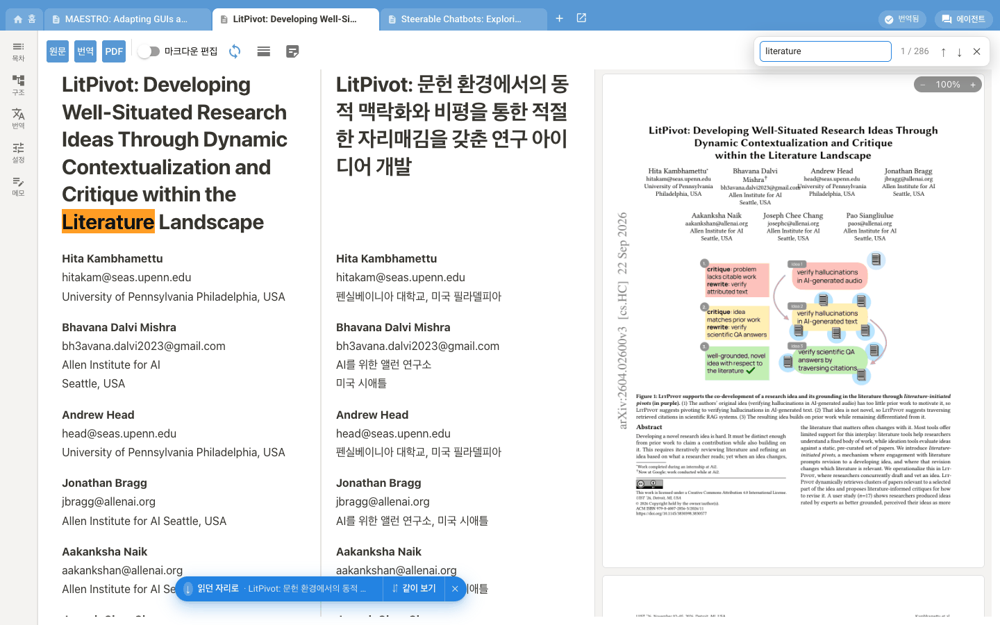

어느 화면에서든 **⌘F / Ctrl+F**로 찾기 막대가 뜹니다. 결과 수(`3 / 26`)를 세고 모두 노란색으로, 지금 결과는 주황색으로 표시합니다. **Enter** 다음, **Shift+Enter** 이전, **Esc** 닫기입니다.

---

## 번역

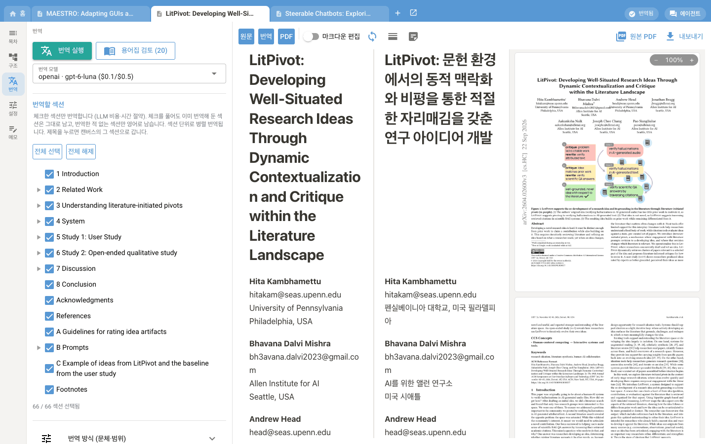

왼쪽 레일의 **번역** 패널입니다. 헤더의 `번역 안 됨 · 번역하기` 칩을 눌러도 열립니다.

1. **번역할 섹션**을 고릅니다. 체크를 푼 섹션은 원문 그대로 남습니다(참고문헌은 빼는 편이 보통입니다).
2. 필요하면 **용어집 검토**로 번역어를 먼저 정합니다(아래).
3. **번역 실행**을 누릅니다. 끝나면 캔버스에 번역 칸이 바로 켜지고, 실제로 든 비용이 표시됩니다.

번역 모델은 패널 위에서 고릅니다. 한 번 번역한 문단은 보관해 두므로, 구조를 고쳐 다시 번역해도 바뀐 문단만 다시 번역합니다.

### 용어집

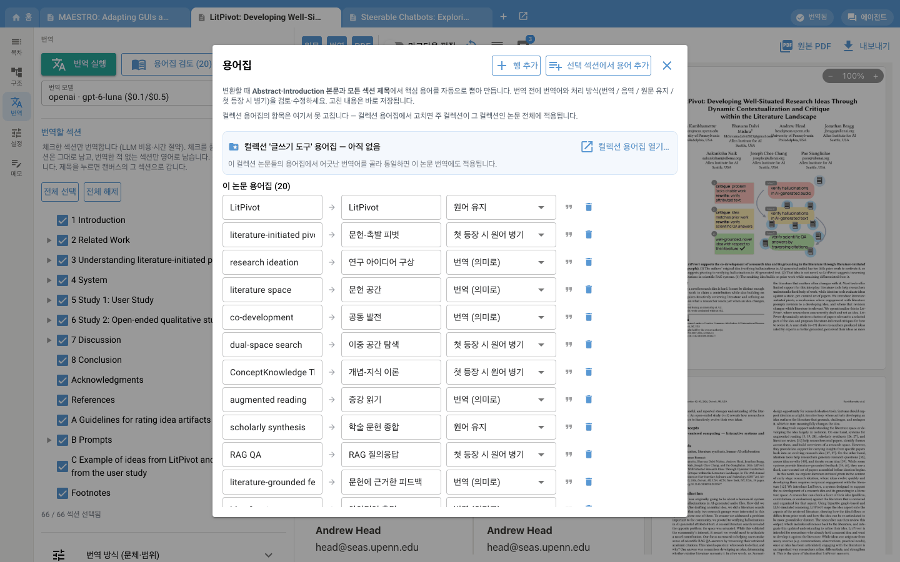

변환할 때 초록·서론과 섹션 제목에서 핵심 용어를 뽑아 둡니다. **용어집 검토**를 누르면 표가 떠서 번역 전에 번역어와 처리 방식을 고칩니다.

- 처리 방식: **번역(의미로)** · **음역(소리로)** · **원어 유지** · **첫 등장 시 원어 병기**(예: "문헌-촉발 피벗(literature-initiated pivot)").
- 이 용어집으로 번역하므로 문서 전체에서 번역어가 흔들리지 않습니다.
- **컬렉션 용어집** — 컬렉션 **⋯ → 용어집…**에서 그 컬렉션 논문들이 함께 쓸 용어를 정합니다. 논문 용어집보다 우선하고, 논문마다 다르게 번역된 용어를 골라 하나로 맞출 수 있습니다. 바꾸면 다시 번역될 섹션 수와 비용을 먼저 보여 줍니다.

### 표기 설정

왼쪽 레일의 **설정** 패널에서 인용 표기(번호·저자 연도·약칭 조합), 참고문헌 링크, 캡션, 저자 표기를 바꿉니다. 바꾸면 **다시 번역하지 않고** 원문과 번역 양쪽에 바로 반영됩니다.

---

## 구조 고치기

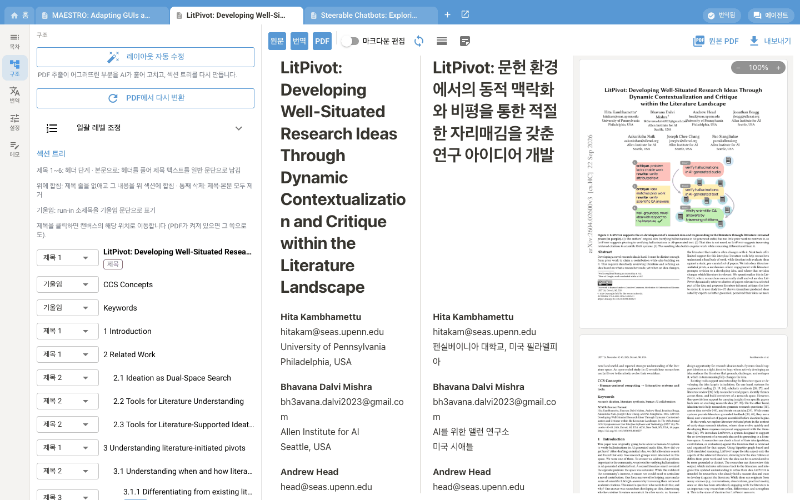

PDF에서 글을 풀다 보면 제목 레벨이 틀리거나 문단이 끊길 때가 있습니다. 왼쪽 레일의 **구조** 패널에서 고칩니다.

- **레이아웃 자동 수정** — 쪼개진 제목, 풀어헤쳐진 수식, 끊긴 문단·목록·표를 AI가 문서 전체에서 찾아 고칩니다. 글의 단어는 바꾸지 않고, 마음에 안 들면 **직전 상태로 되돌리기**로 돌아갑니다.
- **섹션 트리** — 제목마다 레벨(제목 1~6)을 고르거나, 본문으로 풀기·위에 합치기·통째 삭제를 합니다. 고친 판단은 기억해 두었다가 같은 학회 양식의 다음 논문에 자동으로 적용합니다.
- **일괄 레벨 조정** — `3.2.1` 같은 번호 체계를 깊이별로 묶어 한 번에 맞춥니다.
- **PDF에서 다시 변환** — 처음부터 다시 풉니다.
- **마크다운 편집** — 툴바의 토글을 켜면 본문을 직접 고칩니다. 마크다운 기호가 그 자리에서 서식으로 보이는 편집기이고, 원문과 번역 중 어느 쪽을 고칠지 고릅니다. ⌘/Ctrl+B(굵게)·I(기울임)·K(링크), ⌘/Ctrl+⌥1~6(제목), ⌘/Ctrl+⇧8(목록) 같은 단축키가 됩니다. 입력을 멈추면 자동 저장됩니다.

---

## 에이전트 창

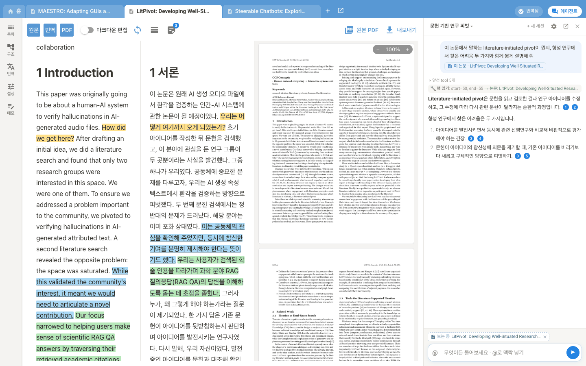

오른쪽 위의 **에이전트** 단추로 엽니다. 오른쪽 한 칸을 차지하고, 홈과 논문을 오가도 대화가 이어집니다. AI 키가 필요합니다.

- **내 논문 전체를 다룹니다.** 질문에 맞춰 논문 검색, 문단 읽기, 목차·메모·하이라이트 읽기를 스스로 하고 답합니다. "4절로 가 줘", "그 논문 열어 줘"처럼 화면을 옮겨 달라고 해도 됩니다.
- **답의 근거 번호를 누르면** 그 문단으로 갑니다. 다른 논문의 근거면 그 논문을 열고 갑니다.
- **지금 보는 화면을 압니다.** 보고 있는 논문·컬렉션, 선택한 글을 함께 보내므로 "이 문단", "선택한 문장"이 통합니다. 입력창에 **@**를 치면 다른 논문·섹션·메모를 골라 맥락으로 넣습니다.
- **메모 쓰기·하이라이트 달기·재번역 같은 일**은 승인 카드가 뜨고, 허락해야 실행합니다.
- 대화는 세션으로 남습니다. 머리줄의 세션 이름을 눌러 지난 대화를 고르고, ⚙에서 모델과 글자 크기를 바꿉니다.

---

## 모바일에서 읽기

<p>
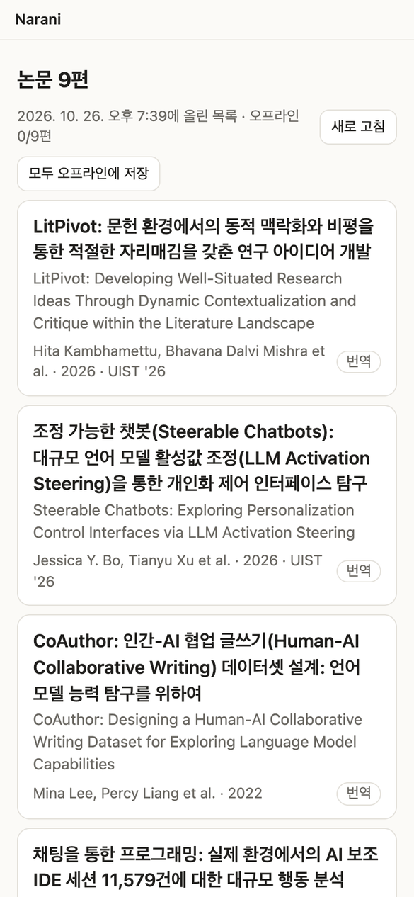
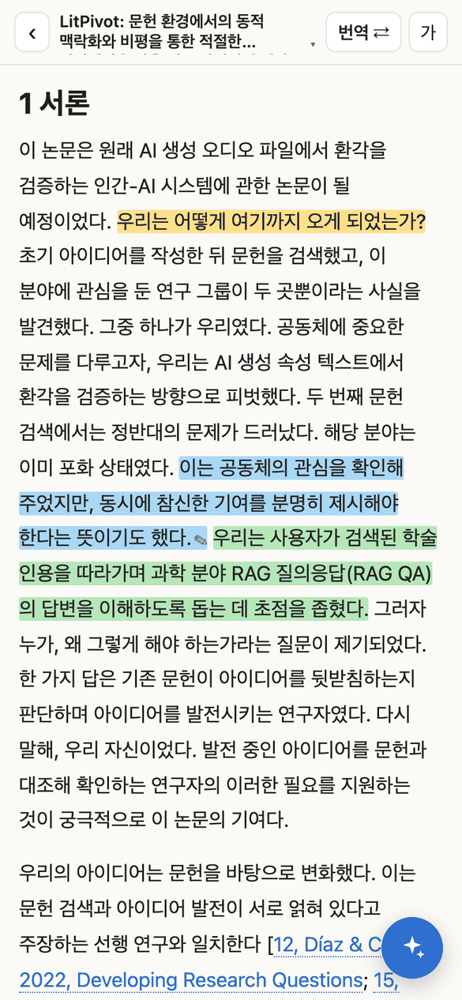
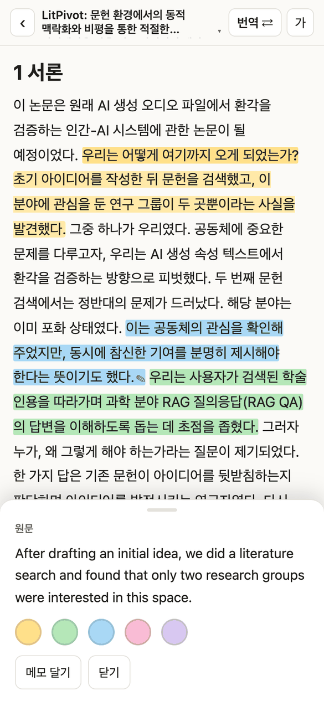
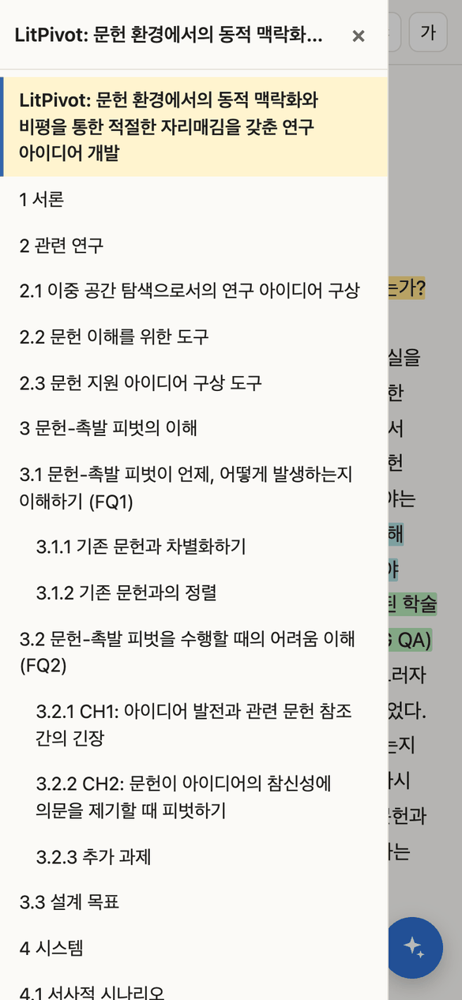
</p>

데스크톱에서 번역한 논문을 폰·태블릿에서 읽고, 폰에서 단 하이라이트·메모를 데스크톱과 주고받습니다.

- **서버가 없습니다.** 논문은 **내 Google Drive의 `Narani` 폴더**를 거쳐 오갑니다. 데스크톱이 꺼져 있어도 폰에서 읽을 수 있습니다.
- **폰 웹앱 주소: https://narani.sangwooklee.info/** — 앱스토어에서 받는 앱이 아니라 홈 화면에 추가해 쓰는 웹앱입니다.
- **권한은 좁습니다.** Narani가 만든 파일만 볼 수 있는 권한(`drive.file`) 하나라 Drive의 다른 파일은 보지 못합니다. 데스크톱의 AI 키는 폰으로 가지 않습니다.

### 1. 데스크톱에서 논문 보내기

1. 홈에서 보낼 논문을 체크하고 **모바일로 보내기**를 누릅니다.
2. 처음 한 번은 브라우저에 Google 로그인 화면이 뜹니다. 로그인하고 허용하면 Drive에 `Narani` 폴더가 생기고 논문이 올라갑니다. (왼쪽 사이드바 **모바일 → Google Drive 연결**로 먼저 연결해도 됩니다.)
3. 목록 오른쪽 위 **⋯ → 이 목록의 번역한 논문을 모두 모바일로 보내기**로 한꺼번에 보낼 수도 있습니다.
4. 논문 카드를 왼쪽 사이드바의 **모바일**로 끌어다 놓아도 보내집니다.

보낸 논문은 카드에 📱 표시가 붙고, 왼쪽 사이드바의 **모바일**에 모입니다. 그 머리에 연결한 계정·편수·용량·마지막으로 맞춘 때와 **지금 맞추기**·**연결 끊기**가 있습니다.

### 2. 폰에 설치하기 (홈 화면에 추가)

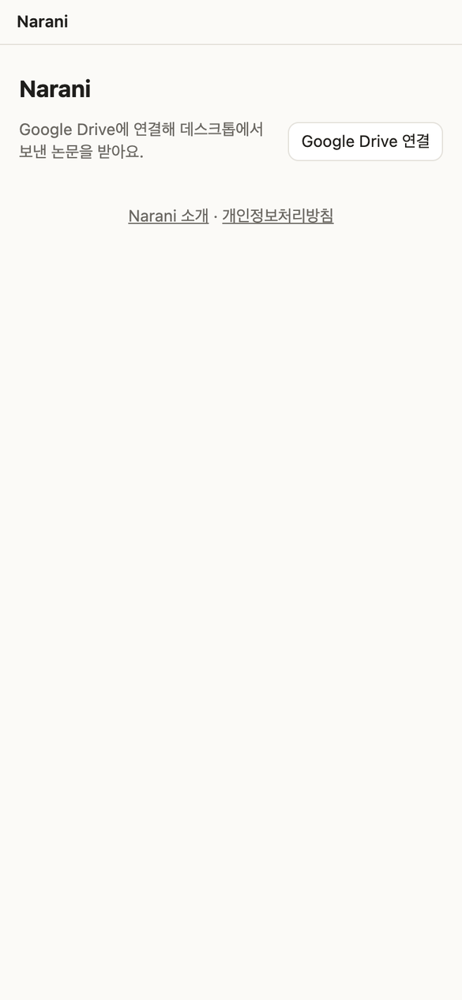

**iPhone·iPad (Safari)**
1. **Safari**에서 https://narani.sangwooklee.info/ 를 엽니다. (Safari에서 하는 것이 가장 확실합니다.)
2. 아래쪽(iPad는 위쪽)의 **공유** 단추(네모에서 화살표가 나온 모양)를 누릅니다.
3. 목록을 내려 **홈 화면에 추가**를 누르고, 오른쪽 위 **추가**를 누릅니다.
4. 이제부터는 **홈 화면의 Narani 아이콘**으로 엽니다. 홈 화면 앱과 Safari 탭은 저장 공간이 따로라서, Drive 연결과 오프라인 저장도 아이콘으로 연 앱에서 해야 합니다.

**Android (Chrome)**
1. **Chrome**에서 https://narani.sangwooklee.info/ 를 엽니다.
2. 오른쪽 위 **⋮** 메뉴에서 **홈 화면에 추가**(또는 **앱 설치**)를 누르고 **설치**·**추가**를 누릅니다.
3. 홈 화면이나 앱 서랍의 **Narani** 아이콘으로 엽니다.

**처음 연 뒤:** **Google Drive 연결**을 누르고 데스크톱과 **같은 Google 계정**으로 로그인하면 보낸 논문 목록이 뜹니다.

<br clear="right">

### 3. 폰에서 읽기

- **목록** — 데스크톱에서 보낸 논문이 보입니다. **새로 고침**은 Drive에서 목록을 다시 받습니다.
- **오프라인 모드** — 목록 위 **오프라인 모드 — 모두 받아 두기**를 켜 두면 모든 논문과 데스크톱의 하이라이트·메모를 폰에 받아 두고, 앱을 열 때마다 새로 올라오거나 바뀐 것만 더 받습니다(비행기·지하철). 켜지 않아도 한 번 연 논문은 받아 둡니다. 인터넷이 없으면 목록에 그렇게 표시되고, 받아 두지 않은 논문은 흐리게 보입니다.
- **위쪽 막대** — **‹** 목록으로, **제목**을 누르면 왼쪽에서 **목차**가 나오고 지금 읽는 절이 표시됩니다. **번역 ⇄**는 번역과 원문을 바꾸고, **가**는 글자 크기를 바꿉니다.
- **문장을 누르면** 아래에서 **짝 문장**(번역을 보고 있으면 원문)이 올라옵니다. 인용을 누르면 참고문헌이 뜹니다.
- **내 메모 목록** — 오른쪽 아래 **✦** 단추의 **메모** 탭에 이 논문의 하이라이트·메모가 본문 순서로 있습니다(**메모만**으로 거르기). 누르면 그 자리로 갑니다. 단추의 숫자가 개수입니다.

### 4. 하이라이트·메모와 동기화

- 문장을 누르고 올라온 칸에서 **색**을 고르면 하이라이트, **메모 달기**를 누르면 메모가 붙습니다. 원문·번역 짝 문장에 함께 칠해지고(데스크톱의 더블클릭 표시와 같은 모양), 메모가 있는 곳에는 ✎가 붙습니다.
- **폰 → 데스크톱**: 폰에서 단 표시는 Drive에 올라가고, 데스크톱 앱을 **켤 때**(또는 사이드바 **모바일 → 지금 맞추기**) 데스크톱의 하이라이트에 합쳐집니다. 인터넷이 없을 때 단 것은 폰에 모였다가 연결되면 올라갑니다.
- **데스크톱 → 폰**: 데스크톱 앱을 켤 때 데스크톱에서 다시 번역하거나 고친 논문과 새 메모를 다시 올립니다. 폰은 앱을 열 때(또는 **새로 고침**) 받아 갑니다.
- 그 논문을 데스크톱 뷰어에 열어 둔 채 맞췄다면, 논문을 다시 열어야 폰 메모가 보입니다.

### 5. 폰에서 질문하기 (선택)

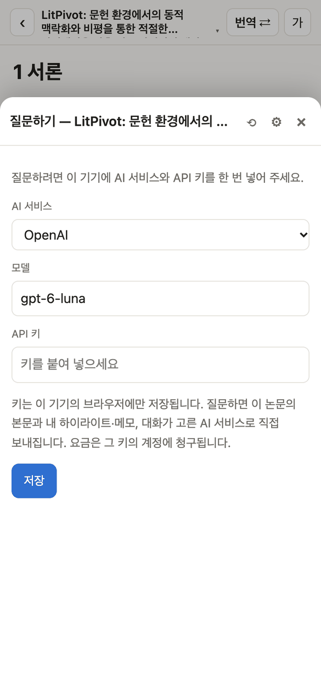

오른쪽 아래 **✦** 단추의 **질문하기** 탭에서 지금 보는 논문에 대해 묻습니다. 답의 [r12] 같은 근거를 누르면 그 문단으로 갑니다.

- 처음 한 번 **그 기기에 내 AI API 키**(OpenAI·Anthropic·Gemini)를 넣습니다. 키는 그 기기의 브라우저에만 저장됩니다.
- 질문하면 그 논문의 본문과 내 하이라이트·메모, 대화가 고른 AI 서비스로 직접 갑니다. 요금은 그 키의 계정에 청구됩니다.
- 서비스·모델 기본값은 데스크톱 에이전트 창에서 고른 것을 따릅니다.

<br clear="right">

### 6. 새 판으로 바꾸기

웹앱은 열 때마다 뒤에서 새 판을 확인해 받아 둡니다. 새 판은 **앱을 완전히 닫았다가 다시 열면** 적용됩니다.

- **iPhone** — 화면 아래에서 위로 쓸어 올려 앱 전환기를 열고, Narani를 위로 밀어 닫은 뒤 다시 엽니다.
- **Android** — 최근 앱 목록에서 Narani를 밀어 닫은 뒤 다시 엽니다.

받아 둔 논문과 메모는 그대로 남습니다.

### 알아 둘 것

- 폰의 Google 로그인은 한 시간쯤 지나면 **다시 연결**을 물을 수 있습니다. 받아 둔 논문은 그대로 읽힙니다.
- 원문·번역의 절 수가 달라 나란히 맞추지 못한 논문은 폰에서 새 하이라이트를 달 수 없습니다(데스크톱에서 단 표시는 보입니다).
- 폰에서 빼려면 데스크톱에서 논문을 체크하고 **모바일에서 빼기**를 누릅니다. 빼기 전에 폰 메모를 데스크톱으로 합쳐 둡니다. 논문 파일은 그대로입니다.
- 연결을 끊으려면 사이드바 **모바일 → 연결 끊기**. Drive에 올린 파일은 남으니 필요 없으면 Drive에서 `Narani` 폴더를 지우세요.
- Google 데이터를 어떻게 쓰는지: [개인정보처리방침](https://narani.sangwooklee.info/privacy.html) · [소개](https://narani.sangwooklee.info/about.html)

---

## 내보내기와 저장 위치

### 내보내기

논문 화면 오른쪽 위의 **내보내기**에서 **영어 마크다운 (zip)**, **번역 마크다운 (zip)**, **하이라이트·메모 (md)**를 받습니다. 같은 메뉴의 **형식**에서 어디에 넣을지 고릅니다.

| 형식 | 쓰는 곳 | 넣는 법 |
|---|---|---|
| **범용** (기본) | GitHub, VS Code·Typora 같은 마크다운 편집기, Pandoc, LLM에 붙여 넣기 | zip을 풀고 `.md`를 엽니다. `.md`와 `images/` 폴더가 같은 자리에 있어야 그림이 보입니다 |
| **Notion** | Notion | 왼쪽 아래 **가져오기(Import) → Markdown & CSV**에서 **zip을 풀지 말고 그대로** 고릅니다. 가져온 뒤 생기는 빈 `images` 페이지는 지우면 됩니다 |
| **Obsidian** | Obsidian | zip을 풀어 `<논문이름>-en` **폴더째** 보관함(vault)에 넣습니다. 본문 인용을 누르면 참고문헌으로 가고 ⌘/Ctrl+←로 돌아옵니다. **폴더 이름을 바꾸면 그림이 깨집니다** |

원본은 항상 범용으로 보관하고 받을 때만 바꾸므로, 형식을 바꿔 다시 받아도 잃는 것이 없습니다.

### 저장 위치 — 정해 둔 폴더에 저절로 쌓기

매번 zip을 받는 대신, **⚙ 설정 → 저장 위치**에서 폴더 하나를 고르면 변환·번역이 끝날 때마다 마크다운이 그 폴더에 쌓입니다.

```
<저장 폴더>/2026_LitPivot_Kambhamettu.md          ← 원문
<저장 폴더>/images/2026_LitPivot_Kambhamettu/     ← 그림
<저장 폴더>/ko/2026_LitPivot_Kambhamettu.md       ← 번역 (폴더 이름은 번역 언어)
<저장 폴더>/pdf/2026_LitPivot_Kambhamettu.pdf     ← 원본 PDF
<저장 폴더>/references.bib                        ← BibTeX
```

- 컬렉션마다 폴더를 따로 정할 수 있습니다(컬렉션 **⋯ → 폴더 정하기**). 폴더를 정하지 않은 컬렉션은 공통 폴더로 갑니다.
- 컬렉션마다 이름 규칙·내보내기 형식·BibTeX·자동 저장을 다르게 둘 수 있습니다(컬렉션 **⋯ → 설정 → 고급**). 정하지 않은 항목은 전역 설정을 따릅니다.
- 파일 이름은 기본 `{year}_{title}_{author}` 규칙을 따르고, **⚙ 설정 → 고급**에서 바꿉니다.

### BibTeX

논문 하나에 항목 하나가 저장 위치의 `references.bib`에 쌓입니다. 원고의 `.bib`에 붙이거나 Overleaf·Zotero로 가져갈 수 있습니다.

- 인용 키는 파일 이름과 같습니다(`\cite{2026_LitPivot_Kambhamettu}`).
- 변환이 끝나면 **Semantic Scholar·Crossref에서 출판 기록을 받아** DOI·학회·쪽수를 채웁니다. 이때 보내는 것은 **논문 제목뿐**입니다. 저자와 연도로 같은 논문인지 확인하고, 확신이 서지 않으면 바꾸지 않습니다.
- 손으로 넣은 다른 항목은 건드리지 않고, 쓴 뒤 파일 전체를 다시 읽어 항목이 줄었으면 되돌립니다.

---

## 비용

**PDF를 글로 푸는 것(추출)은 무료입니다.** 내 컴퓨터에서만 돌아갑니다. 돈이 드는 것은 번역, 용어집 만들기, 참고문헌 정리, 수식 읽기, 그림 글자 번역, 에이전트 질문입니다.

| 논문 | 번역 비용 (2026-07, `gpt-5.6-luna` 실측 기준) |
|---|---|
| 짧은 논문 (본문 약 5만 자) — 실측 | 약 $0.031 (약 45원) |
| 보통 학회 논문 (약 7만 자) | 약 $0.04 |
| 부록까지 긴 논문 (약 24만 자) | 약 $0.14 |

- 지금 기본 모델 `gpt-6-luna`는 단가가 더 낮아 위 금액의 절반 안팎으로 예상됩니다(다시 실측하지는 않았습니다).
- 수식은 하나에 약 $0.0005, 그림 글자 번역은 한 장에 1센트 미만입니다.
- **일괄 번역은 시작 전에 예상 비용을**, 번역이 끝나면 **실제 비용을** 보여 줍니다. 한 번 번역한 문단은 다시 번역하지 않습니다.
- 에이전트는 질문마다 필요한 문단만 읽어 보내므로 번역보다 훨씬 쌉니다. 한 세션의 비용이 $2를 넘으면 계속할지 묻습니다.

---

## 문제 해결

- **아이콘을 눌러도 창이 안 뜸** — 실행 기록(macOS `~/Library/Logs/narani.log`)을 보세요. 설치 줄을 다시 실행하면 대개 해결됩니다.
- **AI 키가 없다고 나옴** — 아이콘으로 연 앱은 터미널의 환경 변수를 보지 못합니다. **⚙ 설정 → AI**에 키를 저장하세요.
- **변환해 둔 논문이 목록에 없음** — 작업 폴더가 다른 곳을 가리키는 것입니다. **⚙ 설정 → 저장 위치 → 작업 폴더**를 예전 폴더로 바꾸세요.
- **첫 변환이 오래 걸림** — 추출 모델(약 1.1GB)을 받는 중입니다. 두 번째부터 빨라집니다.
- **추출 결과가 이상함** — **구조** 패널에서 제목 레벨을 고치거나 **레이아웃 자동 수정**을 돌리고, PDF 칸과 대조하세요. 스캔한 PDF라면 **⚙ 설정 → 변환·번역**에서 OCR을 켜고 다시 변환하세요.
- **폰에 새 논문이 안 보임** — 폰 목록의 **새로 고침**을 누르세요. 그래도 없으면 데스크톱 사이드바 **모바일 → 지금 맞추기**를 누르세요.
- **폰 웹앱이 옛 모습 그대로** — 앱을 완전히 닫고 다시 여세요(→ [새 판으로 바꾸기](#6-새-판으로-바꾸기)).
- **Linux에서 `libGL.so.1` 오류** — `sudo apt install -y libgl1 libglib2.0-0`(Debian/Ubuntu).

그 밖의 설치 방법, 명령줄 사용, 파일 위치는 [개발 문서](docs/DEVELOPMENT.md)에 있습니다.

## 라이선스

[MIT](LICENSE). 무보증(AS-IS)입니다. 의존성도 모두 MIT·BSD·Apache 계열이고 GPL/AGPL 의존성은 없습니다.

변환·번역 **결과물**의 저작권은 원 논문 저작권자에게 있습니다. 재배포해도 되는지는 직접 확인하세요.
